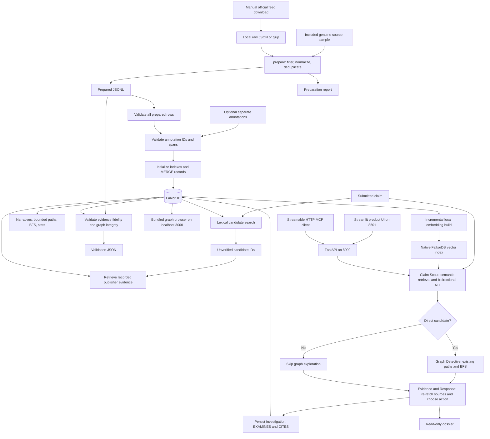

# Project flow register

Last reviewed: **18 October 2026 (Asia/Calcutta)**.

This register covers the implemented local MVP: ingestion, semantic retrieval, specialist decisions, persisted cases, HTTP/MCP access, the interface, tests and local operations. Earlier foundation flows remain valid and are extended below. The architectural reasons are in [Decision.md](Decision.md); stored relationships are in [graph-schema.md](graph-schema.md).

Run commands from the repository root unless stated otherwise. `python` means the installed project environment; on this laptop `.\.tools\python\python.exe` is also available. The equivalent installed CLI entry point is `pehchan`.

## Maintaining this register

Give each new flow a stable `F-NN` ID and document its trigger, inputs, steps, output, persistent effects, failures, source entry point and related ADRs. Update an existing flow when its behavior changes; keep references to superseded behavior where they explain an operational correction. Register new CLI commands, API/MCP endpoints, agent handoffs, background jobs and recovery workflows when implemented. Move proposed flows into the implemented register only when working code exists. This is a maintenance convention, not an automated registration mechanism.

## Current system at a glance



The diagram shows the retained deterministic baseline. Default CLI/API/MCP investigations now use the Gemma tool-calling flow F-32 over the same Scout, graph and evidence policy. The product UI is on 8501; the database browser on 3000 remains a separate administration tool.

## Implemented flow index

| ID | Flow | Entry point / trigger | Persistent write? |
| --- | --- | --- | --- |
| F-01 | Prepare runtime and configuration | Python installation, pip, process environment | Local environment only |
| F-02 | Start database, restore persisted data, open browser | Docker Compose | Database volume; browser session |
| F-03 | Acquire source snapshot | Manual official-feed download | Raw file |
| F-04 | Prepare and audit input | CLI `prepare` | JSONL and report |
| F-05 | Normalize one ClaimReview and derive IDs | `normalize_review` | None itself |
| F-06 | Validate prepared rows | `load_prepared` | None |
| F-07 | Validate and flatten annotations | `load_annotations` | None |
| F-08 | Connect and initialize graph indexes | `GraphStore`, `init_schema` | Indexes on ingest/demo/test paths |
| F-09 | Merge source records and annotations | CLI `ingest`, `GraphStore.ingest` | Nodes and relationships |
| F-10 | Find lexical candidates | CLI `search` | None |
| F-11 | Retrieve publisher evidence | CLI `evidence` | None |
| F-12 | Explore narrative neighbors | CLI `narratives` | None |
| F-13 | Find bounded connection or entity bridge | CLI `path` | None |
| F-14 | Run native BFS | CLI `bfs` | None |
| F-15 | Read graph counts | CLI `stats` | None |
| F-16 | Validate imported evidence and graph behavior | CLI `validate` | Optional local report |
| F-17 | Extract the reproducible source sample | `scripts/build_sample.py` | Sample, annotations, manifest |
| F-18 | Run the complete foundation demo | `scripts/validate_demo.py` | Demo graph and artifacts |
| F-19 | Run unit/integration checks | pytest, Ruff | Temporary test graphs and caches |
| F-20 | Dispatch CLI, serialize results, handle failures | `cli.main` | Command-dependent |
| F-21 | Recover from import failure or lost container data | Operator-initiated replay/restore | Restored graph |
| F-22 | Register architecture and workflow changes | Implementation/documentation change | Markdown documentation |
| F-23 | Download models and build incremental embeddings | `download-models`, `embed`, `embedding-status` | Local checkpoints, graph vector properties/index |
| F-24 | Retrieve semantic candidates and assess relevance | `semantic-search`, `scout`, ClaimScout | None after setup |
| F-25 | Orchestrate three specialist handoffs and assemble dossier | `dossier`, Orchestrator.assemble | None |
| F-26 | Persist, retrieve and follow up investigations | `investigate`, `cases`, `case`, `review` | Investigation nodes/links and follow-up metadata |
| F-27 | Route and authorize HTTP operations | FastAPI routes | Operation-dependent |
| F-28 | Discover and invoke tools through MCP | `/mcp/` Streamable HTTP | Action tools only |
| F-29 | Investigate, inspect graph and manage cases in the UI | Streamlit on 8501 | Via authorized API actions only |
| F-30 | Verify the full MVP with real clients/models | Evaluation and smoke scripts | Evaluation artifacts and tagged demo cases |
| F-31 | Launch local API and UI processes | `scripts/run_local.py` | Local processes/logs |
| F-32 | Infer with Gemma and execute validated tool calls | CLI/API/MCP investigation or dossier | Case writes only after successful assembly via F-26 |
| F-33 | Configure and verify hosted Gemma inference | Environment and `scripts/smoke_inference.py` | Local report; no case |
| F-34 | Annotate the whole collection with keyword rules | `scripts/annotate_collection.py`, then F-09 | Annotation JSON; then graph edges |
| F-35 | Widen through shared entities/frames and classify the finding | Every dossier/investigation without a direct match; MCP `expand_narrative_context` | None |
| F-36 | Recall a prior submission and write a submission back | Start of every dossier/investigation; end of persisted investigations | Submission node and SUBMITTED/MATCHES/MENTIONS/USES_FRAME edges (investigations only) |
| F-37 | Compare retrieval methods on held-out queries | `scripts/evaluate_retrieval.py` | `Docs/retrieval-evaluation.json` |
| F-38 | Use the web app | Browser at `/` | Only through the write route when saving a case |
| F-39 | Publish a public read-only endpoint | `scripts/run_public.py` | Tunnel, public API process, token and endpoint files |
| F-40 | Load the graph into another FalkorDB (e.g. Cloud) | `scripts/load_graph.py` | Target graph nodes, edges, vectors and index |
| F-41 | Test and deploy on every push | GitHub Actions `ci-cd.yml` | EC2 update and/or Space rebuild (main only, when configured) |
| F-42 | Provision an EC2 server | `deploy/ec2/setup.sh` | Packages, app, restored graph, env file, service, Caddy |

## F-01 — Prepare runtime and configuration

**Entry:** [pyproject.toml](../pyproject.toml), [requirements.lock](../requirements.lock), [.env.example](../.env.example). **Decisions:** ADR-002, ADR-022, ADR-023, ADR-028.

**Trigger and inputs:** A developer sets up a checkout with Python 3.11+ and Docker's Linux engine.

**Steps:** Create a Python environment → install editable package and the intended extras using tested constraints (`semantic,server,ui,dev` for the full MVP) → export connection variables if defaults are unsuitable → choose a graph using `--graph`, then `FALKORDB_GRAPH`, then default `pehchan`. Python 3.12 is the tested pinned environment; activation scripts are optional when invoking the environment's Python executable directly.

**Outputs and effects:** Installed package, CLI and dependencies. No source data is fetched and no application graph is ingested by installation.

**Branches:** `.env.example` is documentation; copying it does not cause Python to load `.env`. Host/port default to `127.0.0.1:16379`. A missing runtime/dependency is a setup failure. The portable workspace runtime is a local fallback; it is ignored by Git.

```powershell
python -m pip install -c requirements.lock -e ".[dev]"
```

## F-02 — Start services, restore persistence, and inspect the graph browser

**Entry:** [compose.yaml](../compose.yaml). **Decisions:** ADR-023, ADR-024, ADR-025.

**Trigger:** `docker compose up -d --wait`.

**Steps:** Resolve the pinned combined FalkorDB/browser image → mount named volume at `/var/lib/falkordb/data` → pass AOF settings through `REDIS_ARGS` → start Redis/FalkorDB and the bundled browser → Redis loads existing persistence files when present → wait for `redis-cli ping` health check.

**Connections:** Laptop Python → `127.0.0.1:16379` → container database `6379`. Laptop web browser → [localhost:3000](http://localhost:3000) → bundled UI. The UI's server-side database connection uses `127.0.0.1:6379` inside the container. The local setup uses no database password. Select `pehchan` or `pehchan_demo` after connection.

**Outputs and effects:** Running container, reachable browser, loaded graph namespaces, persisted database updates. The health check confirms Redis responsiveness; it is not a browser HTTP or graph-content check. Browser HTTP availability was separately checked with status 200.

**Failure branches:** Engine unavailable, occupied host port, unhealthy service or image failure → inspect Compose status/logs. Browser unreachable with a healthy database → check the 3000 mapping separately. Empty graph list → check graph selection, import status and persistence, then use F-21. Direct HTTP requests to the Redis port are not browser requests.

**Persistence verification:** After correcting the mount and AOF configuration, the graphs were restored, the container was recreated again, and both namespaces plus the 250-review main graph remained available. Ordinary stop/start or recreation retains the named volume. Volume deletion is outside that retention guarantee.

## F-03 — Acquire a source snapshot

**Entry:** Manual download commands in [README](../README.md#import-the-larger-feed). **Decisions:** ADR-004, ADR-005, ADR-006, ADR-028.

**Inputs:** Official current feed URL and a local output path such as `data/raw/claimreview-latest.json`.

**Steps:** Download the file → verify the download completed and is structured data → retain the local snapshot → pass its origin label/path to `prepare` in F-04. Alternatively, begin with `data/samples/claimreviews.json` without a download.

**Outputs and effects:** A local raw snapshot. Preparation later computes its SHA-256. Raw downloads are ignored by Git; the sample manifest records the original feed attribution/hash/index mapping.

**Branches:** Historical research link returned HTML during initial setup, so acquisition switched to the official current feed. A failed or partial download must not be treated as source data. There is no automatic downloader, retry scheduler, crawler, publisher-article fetch or API enrichment in the Python package.

## F-04 — Prepare and audit source input

**Entry:** [prepare / iter_reviews / unwrap](../src/pehchan/ingestion.py). **Decisions:** ADR-006 through ADR-013.

**Trigger:** `python -m pehchan.cli prepare INPUT --output OUTPUT --report REPORT --source ORIGIN`.

**Inputs:** Distinct input/output/report paths; optional repeated `--contains` substrings; optional positive `--limit`.

**Steps:**

1. Validate limit and distinct paths; hash the source file in chunks.
2. Select gzip/plain reader. Read JSONL/NDJSON line by line, or discover an array/DataFeed/`@graph`/single-record JSON container using `ijson`.
3. Unwrap supported envelopes into ClaimReview objects. Increment a one-based review index and the scanned count.
4. Apply case-insensitive OR substring filters to `claimReviewed`; increment `filtered` for misses.
5. Normalize each selected raw record through F-05.
6. Compare its review identity against the accepted-record map. Equal rating object → count duplicate and skip; different rating object → abort as a conflict.
7. Write accepted normalized records to a temporary sibling JSONL file; collect per-record warnings/rejections. Stop when the unique accepted-record limit is reached.
8. On successful iteration with at least one scanned review, replace the output path and write the detailed audit report. The CLI prints a compact summary with counts and report path.

**Outputs:** Prepared JSONL and report containing origin/hash, scanned/selected/duplicate/filtered counts, rejected source indices and reasons, and warning indices/codes.

**Failure branches:** A handled record-level `RecordError` is reported and skipped. A rating conflict writes an `aborted` report and raises; the old output is retained. Parser/I/O failures propagate and the temporary file is removed; they do not guarantee a new audit report. No reviews scanned → error. Reviews scanned but all filtered/rejected → an empty output may be written; F-06 rejects it. The accepted-record limit means the remainder of the source is not examined for later conflicts or matches.

**Boundary:** Source preparation does not contact FalkorDB. Replacing JSONL and writing its report are separate filesystem operations.

## F-05 — Normalize one ClaimReview

**Entry:** [records.py](../src/pehchan/records.py): `normalize_review`, `canonical_url`, `organization`, `parsed_date`, `normalize_text`, `stable_id`. **Decisions:** ADR-008 through ADR-012.

**Inputs:** Parsed ClaimReview dictionary, source label, source-file hash, one-based review index.

**Steps:** Require nonempty claim text → validate/canonicalize HTTP(S) review URL while retaining original → require a rating object and source rating value → resolve reviewing organization or domain fallback → normalize text and choose language (`und` if absent) → parse independent review/claim dates → derive deterministic IDs → attach original markup, rating, license and provenance → return schema-version-1 record.

**Publisher branch:** Review-level `publisher` is preferred, then suitable review-level `author`, then source URL domain. Entries explicitly typed `Person` are excluded. Claim originator under `itemReviewed.author` and markup distributor under `sdPublisher` are not used as publisher identity.

**Rating branch:** Use text `alternateName`, then text/numeric `ratingValue`. Retain the complete rating object so scales are available. No normalized true/false verdict is inferred.

**Date branch:** Missing dates stay empty. Invalid supplied date text adds a warning; absent/invalid review date also produces `MISSING_REVIEW_DATE`. Missing organization naming produces `PUBLISHER_NAME_UNAVAILABLE` with a domain fallback.

**Outputs and effects:** A normalized Python dictionary, no database write. Required-field errors return to F-04's rejection handling. Canonical URL generation does not visit the source page.

## F-06 — Validate prepared records before database work

**Entry:** [load_prepared](../src/pehchan/ingestion.py). **Decisions:** ADR-012, ADR-013, ADR-016.

**Trigger:** CLI `ingest` or `validate`; sample extraction and demo/test setup also call it.

**Steps:** Read nonblank JSONL rows → recompute each row from its embedded raw record and provenance fields via F-05 → compare the complete stored/recomputed dictionaries → accumulate records → reject an empty dataset or duplicate review IDs.

**Outputs:** A list of validated prepared rows, held in memory.

**Failure branches:** Missing fields, invalid JSON, altered normalized data, empty input or repeated review IDs stop the operation before the CLI constructs its GraphStore. This does not independently authenticate the source or rehash the original feed; it checks consistency with the raw record embedded in the prepared file.

## F-07 — Validate and flatten optional annotations

**Entry:** [load_annotations](../src/pehchan/annotations.py). **Decisions:** ADR-014, ADR-015.

**Inputs:** Optional annotation JSON path and F-06 records.

**Steps:** No file → return `[]`. Otherwise require an array → build a variant-ID lookup → require each annotation to reference a prepared variant → require reviewer label and rationale → validate frame/topic/entity collections and names → require entity type and an evidence span found in normalized claim text → derive stable annotation node IDs → flatten the row into individual frame/topic/entity operations attached to the canonical claim ID.

**Outputs:** Validated annotation operations, each carrying its source variant, reviewer, rationale, name/type/description and applicable evidence span.

**Failure branches:** Unknown variant, malformed collection, absent attribution, missing entity type or nonexistent span → `RecordError` before CLI ingestion creates indexes or graph records. No annotations are generated automatically by this validator. A matching span does not establish correct entity identity or factual truth.

## F-08 — Connect and initialize schema indexes

**Entry:** [GraphStore.__init__ / init_schema](../src/pehchan/graph.py), [LABELS](../src/pehchan/queries.py). **Decisions:** ADR-003, ADR-015 through ADR-017, ADR-022.

**Steps:** Resolve graph selection and connection environment → validate graph name format/length → create the synchronous SDK client with timeouts → select its named graph handle. On ingest/demo/test paths, create an ID range index for each of eight declared labels.

**Outputs and effects:** Graph handle and, when initialization is requested, ID indexes. Index creation can create an otherwise empty graph/label schema. No placeholder Investigation record is inserted; real records are created through F-26. Vector indexes have their own initialization in F-23.

**Failure branches:** Invalid graph name → input error. Connection/server failures → operation error. Exactly the known already-indexed response is tolerated on rerun; other index errors propagate. Exploration commands do not call `init_schema` and do not run application write queries. Range indexes are not uniqueness constraints.

## F-09 — Ingest source records and curated relationships

**Entry:** CLI `ingest`, [GraphStore.ingest](../src/pehchan/graph.py), [UPSERT_REVIEW](../src/pehchan/queries.py). **Decisions:** ADR-012, ADR-014 through ADR-017, ADR-026.

**Inputs:** Prepared rows and optional annotations that already passed F-06/F-07; target graph.

**Steps:** Initialize indexes through F-08 → for each source row serialize nested rating/raw/license objects to JSON properties → issue one parameterized query merging variant, canonical claim, review and publisher with their three source relationships → after all reviews, merge annotation nodes and claim relationships using the fixed frame/topic/entity allowlist → return F-15 counts.

**Stored edges:** `EXPRESSES`, `CHECKS`, `PUBLISHED_BY`, and optional `USES_FRAME`, `ABOUT_TOPIC`, `MENTIONS`. Source values remain distinct from annotation provenance.

**Outputs and effects:** Persistent graph nodes/properties/relationships plus JSON counts. A sequential repeat of identical input should retain counts. Main and demo graphs are separate to avoid overwriting shared review provenance with a differently hashed sample file.

**Failure/retry branch:** A source row is atomic within its query, but the whole dataset and annotation pass are not. Database failure may leave earlier rows committed. Fix connectivity/input as appropriate and rerun against the same intended graph. Ingestion does not remove nodes/edges absent from input, repair conflicting preexisting identities, or coordinate concurrent writers.

## F-10 — Search for lexical candidates

**Entry:** CLI `search CLAIM`, [GraphStore.candidates](../src/pehchan/graph.py), `VARIANTS` query. **Decisions:** ADR-003, ADR-018.

**Inputs:** Nonempty submitted text; internal/default limit 5 (method accepts 1–20).

**Steps:** Normalize and tokenize submitted text → query all stored variants from FalkorDB → tokenize each stored normalized text → compute Counter intersection/union overlap → discard zero scores → round scores to six decimals → sort by descending score and variant ID → cap results.

**Outputs:** Variant ID, stored wording, numeric lexical score, `method=token_jaccard_baseline`, `relevance=unverified_candidate`.

**Branches:** Empty/invalid input limit → error. No positive overlap → `[]`. A positive match does not establish a paraphrase or evidence sufficiency. This explicit lexical baseline never creates a case. The new orchestration path in F-25/F-26 does persist no-match cases. No persistent write occurs in `search`.

## F-11 — Retrieve source evidence for a variant

**Entry:** CLI `evidence VARIANT_ID`, [GraphStore.evidence](../src/pehchan/graph.py), `EVIDENCE` query. **Decisions:** ADR-010 through ADR-012, ADR-019.

**Steps:** Match variant ← `CHECKS` ← review → `PUBLISHED_BY` → publisher → return deterministic review-ID order → decode stored rating/raw JSON properties.

**Outputs:** Review ID, source URL, original verdict, review date, publisher name, dataset origin/hash/index, full original rating and parsed source record.

**Branches:** Unknown or unreviewed variant → `[]`. Malformed stored JSON/server failure → operation failure. The supplied ID is a query parameter, never a Cypher fragment. This retrieves stored markup, not an online page fetch or new evaluation of the submitted claim. No persistent write occurs.

## F-12 — Explore narrative neighbors with provenance

**Entry:** CLI `narratives VARIANT_ID`, [GraphStore.narrative_paths](../src/pehchan/graph.py), `NARRATIVE_PATHS` query. **Decisions:** ADR-014, ADR-019.

**Inputs:** Variant ID; default result limit 20 (method accepts 1–100).

**Steps:** Traverse variant → canonical claim → shared frame ← another claim ← related variant → exclude original variant → require a review and publisher for the related variant → return ordered path node IDs/types, edge provenance and related source evidence → attach explicit uncertainty labels.

**Outputs:** Related claim wording/ID, frame name, path IDs, relationship types and origins, related review/publisher IDs, URL, original verdict, and `narrative_context_only` relevance.

**Branches:** No start, annotation, related claim or related review → `[]`. Multiple reviews/frames can produce multiple findings, capped by the query limit. The related verdict remains attached to the related variant; it is not transferred to the submitted claim. No persistent write occurs.

## F-13 — Find a bounded connection, including entity bridges

**Entry:** CLI `path FROM_ID TO_ID`, [GraphStore.shortest_path](../src/pehchan/graph.py), `SHORTEST_PATH` query. **Decisions:** ADR-020.

**Steps:** Match both variants → enumerate paths of 1–8 edges in either direction across only `EXPRESSES`, `USES_FRAME`, `MENTIONS` → order by length → return one minimum-length bounded path.

**Outputs:** A query result row containing ordered node IDs and relationship types. For example, two claims in different frames can connect through their shared explicitly annotated `5G` entity.

**Branches:** Missing endpoint or no path within the allowed types/hop bound → `[]`. No claim about longer paths follows from this result. Shared publisher/topic shortcuts are excluded. This is not a native `shortestPath` call, does not return full per-edge annotation provenance, and performs no persistent write.

## F-14 — Run native breadth-first traversal

**Entry:** CLI `bfs VARIANT_ID`, [GraphStore.bfs](../src/pehchan/graph.py), `BFS` query. **Decisions:** ADR-021.

**Steps:** Validate depth (default 3, method range 1–6) → match starting variant → call `algo.BFS(v, depth, null)` in FalkorDB → project visited node IDs and traversed edge types.

**Outputs:** Reachable nodes after the start and an edge collection. On the tested server outgoing variant → claim → annotation edges are followed; reverse claim/frame connections are handled by F-12/F-13 instead.

**Branches:** Unknown start → no query row. Invalid depth → input error. Server/algorithm error propagates. The BFS edge collection is not a single narrative evidence path. No persistent write occurs.

## F-15 — Read graph statistics

**Entry:** CLI `stats`, [GraphStore.stats](../src/pehchan/graph.py). **Decisions:** ADR-015, ADR-027.

**Steps:** Count nodes by first label → count relationships by type → convert both result sets into named JSON maps.

**Outputs:** `nodes` and `relationships` count dictionaries. Empty/unpopulated labels do not receive synthetic zero-count records. Counts are also used after ingestion, during validation and for repeated-ingestion comparison.

**Boundary:** Counts demonstrate shape/size, not semantic correctness. Reads are separate queries, not one isolated snapshot under concurrent mutations. No persistent write occurs.

## F-16 — Validate imported source fidelity and graph behavior

**Entry:** CLI `validate INPUT [--require-narrative] [--output FILE]`, [GraphStore.validate](../src/pehchan/graph.py). **Decisions:** ADR-012, ADR-021, ADR-027.

**Steps:** Validate prepared input via F-06 → retrieve each variant's evidence via F-11 → find a row matching expected review ID, URL, verdict, complete raw markup, rating, file hash and source index → check duplicate node IDs → check reviews lacking a claim or publisher relationship → check that each variant expresses exactly one canonical claim → execute BFS from the first input variant → look for one narrative path from any input variant → if found, reproduce its connected pair through F-13 → append current counts.

**Outputs:** `ok`, graph name, checked-record count, failure list, counts and example algorithm/path results. Optional UTF-8 JSON report under the specified path.

**Branches:** Missing/altered evidence or failed integrity assertions → `ok=false`, CLI exit 1. No narrative path is permitted by default, but fails with `--require-narrative`. Unhandled input/network/storage errors use the CLI error path in F-20. A database exception stops the command rather than becoming an invented successful report. The check does not compare every possible graph property/relationship or independently validate publisher claims.

## F-17 — Build the genuine sample and annotation files

**Entry:** [scripts/build_sample.py](../scripts/build_sample.py). **Decisions:** ADR-005, ADR-006, ADR-014, ADR-028.

**Trigger:** `python scripts/build_sample.py data/processed/claims.jsonl` from repository root.

**Steps:** Validate prepared feed through F-06 → index by variant ID → require every hardcoded selected ID → copy the 12 selected raw ClaimReview objects without editing source fields → create the explicit frame/topic/entity annotations with AI-assistance disclosure → create manifest entries for original URLs, publishers and source indices → write the three sample JSON files.

**Outputs and effects:** Rewrites `data/samples/claimreviews.json`, `annotations.json` and `manifest.json` relative to the working directory. No database operation.

**Branches/limits:** Missing selected IDs → error before writes; later feed snapshots may not reproduce the selection. The manifest acquisition date is currently fixed to the original 18 October 2026 snapshot; using the script for a new acquisition requires checking/updating that date and attribution. This script is a documented curated selection, not an automatic narrative classifier.

## F-18 — Execute the reproducible end-to-end foundation demo

**Entry:** [scripts/validate_demo.py](../scripts/validate_demo.py). **Decisions:** ADR-001, ADR-006, ADR-026, ADR-027.

**Trigger:** `python scripts/validate_demo.py [--graph NAME]`; default target `pehchan_demo`.

**Steps:** Resolve repository paths from the script location → prepare the included sample under `artifacts/demo/` → validate prepared rows and annotations → connect/init indexes → ingest sample twice and compare counts → require narrative validation → search the known paraphrased microchip-reader example → retrieve its first candidate's publisher citations → find an entity bridge between the fixed 5G-related variants → run the deliberately unmatched quartz-clock example → combine checks and write `artifacts/demo/validation.json` → close the client.

**Outputs and effects:** Persistent demo graph, prepared demo JSONL, preparation report, validation report and compact console summary.

**Branches:** Any expected match/path/idempotence/empty-candidate assertion failing makes final `ok=false` and exits 1. Unexpected exceptions propagate; client closure is in `finally`. No autonomous agent, dossier, investigation record or review case is created. Reusing a populated arbitrary graph can affect expected sample results; use the intended demo namespace.

## F-19 — Run checks and clean up test-owned data

**Entry:** [unit tests](../tests/test_ingestion.py), [integration tests](../tests/test_graph_integration.py), [fixtures](../tests/conftest.py). **Decisions:** ADR-023, ADR-026 through ADR-028.

**Unit flow:** `python -m pytest -q -m "not integration"` → synthetic fixture records → check source container formats, identities/negation, ratings/dates/URLs, duplicate/conflict handling, modified prepared rows, invalid annotation spans, filters and interrupted preparation. Temporary files are managed by pytest fixtures.

**Integration flow:** Set `PEHCHAN_INTEGRATION=1` → create a unique `pehchan_test_*` graph per test → exercise synthetic and genuine sample ingestion → check rerun counts, evidence fidelity, four-hop narrative paths, BFS, entity bridging, unmatched input and parameterized injection resistance → delete only that test-owned graph and close the SDK client in `finally`.

**Static check:** `python -m ruff check --isolated src tests scripts` checks the code. The first foundation run had 15 passing tests; the later full local MVP run has 38. These are run snapshots, not permanent assertions about future code. New API, model and UI checks are described in F-30.

**Branches:** Without the integration flag, database tests skip. With the flag but without a usable database, they fail. Cleanup failures can surface as test errors. Persistent main/demo graphs are not the test cleanup targets.

## F-20 — Dispatch commands, format results and report failures

**Entry:** [cli.main](../src/pehchan/cli.py). **Decisions:** ADR-002, ADR-017, ADR-022.

**Command coverage:** `prepare`, `ingest`, `validate`, `search`, `evidence`, `narratives`, `path`, `bfs`, `stats`, `download-models`, `embed`, `embedding-status`, `semantic-search`, `scout`, `dossier`, `investigate`, `cases`, `case`, `review`. The global `--graph` option appears before the subcommand.

**Steps:** Parse arguments → execute file preflight for ingest/validate → validate annotations for ingest → construct GraphStore for database commands → invoke the relevant registered flow → render Unicode JSON → compact preparation counts for stdout while retaining detailed report → optionally write validation JSON → close the database client in `finally`.

**Exit behavior:** Success → 0; completed validation with `ok=false` → 1; handled runtime/input/I/O/Redis/JSON errors → 2. Missing local model/dependency setup is reported as a setup error. `argparse` also uses its normal help/error exits. Input errors print a reason; other handled operational errors print their class and a diagnostic hint without dumping client connection secrets. Unexpected exceptions are not all swallowed.

**Output boundary:** Validation prints its JSON before writing `--output`; an output-file failure can therefore follow a printed result and still exit 2. Prepared-row and annotation preflight happen before CLI graph mutation, but direct method callers are responsible for invoking those validators themselves.

## F-21 — Recover from partial imports or persistence mistakes

**Entry:** Operator actions using [Compose](../compose.yaml), F-04/F-09/F-16/F-18. **Decisions:** ADR-016, ADR-025, ADR-026, ADR-028.

**Partial import:** Keep source/prepared files → resolve the cause → rerun ingest with the same intended dataset and graph → validate evidence → confirm stable counts on repeat. Earlier successful row queries are retained, so do not assume a failed import rolled everything back.

**Container recreation:** Confirm the named volume is mounted to the actual configured Redis directory and AOF is enabled → recreate/start the container → list graphs → verify main counts and evidence. The initial incorrect `/data` mount and ignored command flags were replaced by the current correct directory and `REDIS_ARGS`; the correction was verified by a second recreation.

**Lost data:** Rebuild `pehchan` from the preserved prepared 250-record subset plus included annotations, then validate with `--require-narrative`. Rebuild `pehchan_demo` through F-18. Re-run F-23 embeddings after rebuilding claims. If only raw data remains, run F-04 first. If the original snapshot/volume is unavailable, the stable included sample remains reproducible, but a changing online feed cannot guarantee reconstruction of the identical larger snapshot. Investigation snapshots need their own exports/volume backup; recreating source records does not reconstruct user case history.

**Effects/limits:** Recovery is an explicit operator workflow, not an automated backup service. It cannot recover arbitrary manual browser edits or investigation records that were never exported. Do not delete named volumes as part of ordinary recovery.

## F-22 — Register a project change

**Entry:** [Decision.md](Decision.md), [this register](Flow.md), [agent instructions](../AGENTS.md), [README](../README.md). **Decisions:** ADR-029.

**Trigger:** An architectural choice, changed workflow, new component or operational correction.

**Steps:** Identify new/replaced ADRs → record choice, reason, consequences and implementation links → add/update affected flow IDs with triggers, inputs, branches, outputs and side effects → mark proposed/implemented status accurately → update schema/setup references if affected → verify local links and file casing → include documentation with the implementation change.

**Outputs:** Current decision and flow registers. Historical snapshot artifacts retain their original run context. No watcher or CI freshness check currently enforces this workflow.

## F-23 — Download pinned models and index claim vectors

**Entry:** [models](../src/pehchan/models.py), [VectorIndex](../src/pehchan/semantic.py). **Decisions:** ADR-030, ADR-031.

**Triggers:** `download-models`, `embed`, `embedding-status`.

**Download steps:** Resolve model root from `PEHCHAN_MODEL_DIR` or workspace `.models` → download only permitted safetensors/config/tokenizer files at fixed repository revisions → write model identity markers. This is an explicit network/setup operation. Inference afterward uses local files only, CPU, and no remote model code.

**Embedding steps:** Read existing variant IDs/text → inspect per-node model/revision/text-hash metadata and index definition → reject incompatible dimension/metric → initialize the cosine vector index when absent → encode only stale/missing variants in bounded batches → normalize and validate finite 384-value vectors → update each variant only if its text still matches the read version → report coverage, written and skipped counts.

**Outputs/effects:** Downloaded local checkpoints and metadata; graph `embedding`, `embedding_model`, `embedding_revision`, `embedding_text_sha256`, and native vector index. `embedding-status` reads coverage/index state without loading models or changing graph data.

**Failure branches:** Missing ingestion, failed download, wrong local marker/model shape, invalid vector, changed source text during writing, incompatible index or database error → failure. Embedding writes are per row; rerun to finish. Changing/expanding the dataset makes stale/missing coverage visible. Status scans are currently linear in collection size. No source verdict or claim identity is changed.

## F-24 — Retrieve semantic candidates and verify textual relevance

**Entry:** CLI `semantic-search`/`scout`, [ClaimScout](../src/pehchan/semantic.py). **Decisions:** ADR-031, ADR-032.

**Inputs:** Claim text of 1–4000 characters, target graph, limit (default 10, allowed 1–20).

**Steps:** Embed submitted text → require complete fresh compatible graph vectors → native vector query with parameterized input → sort cosine distance ascending and convert to similarity → reject candidates below 0.45 → language-detect query/candidate → abstain on unsupported/uncertain language or an over-512-token NLI pair → otherwise run both query→candidate and candidate→query NLI → classify using the explicit two-direction rules → retrieve publisher evidence for retained matches/context → build structured Scout handoff.

**Outputs:** Same-proposition matches, contradictory/related/uncertain context, rejected neighbors, language results, raw directional NLI scores, model revisions, handoff IDs and an outcome (`CANDIDATE_MATCHES_FOUND` or `NO_CONFIDENT_MATCH`). `semantic-search` stops at indexed neighbors; `scout` performs assessment/evidence handoff.

**Branches:** Missing/stale vectors/index → setup error, never a silent lexical fallback. Unsupported languages can still retrieve multilingual neighbors but receive no confident English-model equivalence. One-direction entailment remains context; one-direction contradiction is uncertain. Unfamiliar claims can have only rejected neighbors. Only same-proposition IDs are delegated to the Detective. No persistent write occurs and no source rating is assigned to the query as its truth verdict.

## F-25 — Orchestrate specialists and assemble a dossier

**Entry:** CLI `dossier`, [Orchestrator / specialists](../src/pehchan/investigation.py). **Decisions:** ADR-033, ADR-034, ADR-045, ADR-046.

**Steps:**

0. Orchestrator recalls earlier submissions (F-36). A near-identical submission with a direct match replaces step 1 with its MATCHES edges.
1. Claim Scout invokes its permitted `find_similar_claims` capability and returns F-24 output.
2. If direct IDs exist, Graph Detective examines at most three, queries their narrative paths, executes native BFS, and seeks an explicit bounded connection between candidates or a discovered neighbor.
3. If no direct ID exists, record the Detective as skipped with `NO_CONFIDENT_CANDIDATE_MATCH`; do not invent graph relationships.
4. Evidence & Response re-fetches sources for direct and contradictory candidates through its own evidence capability. Exclude mismatched original claim wording. Retain publisher ratings and exact provenance, and report missing dates.
5. Choose a dossier-ready, human-review or insufficient-evidence action according to ADR-034. Include quality summary, graph findings, Scout handoff, explicit uncertainties, rule-based priority, specialist policies and real tool traces.
6. Without a direct citation, Graph Detective widens through shared entities/frames, then the finding, review queue and drafted reply are set (F-35).

**Outputs:** A structured source-backed dossier. This path does not persist a case; F-26 adds that action. This fixed specialist sequence remains available in explicit deterministic mode. F-32 is now the default application/CLI generative inference path. An unapproved specialist tool call is rejected. Exceptions propagate rather than being converted to a fabricated successful report.

## F-26 — Persist, retrieve and follow up a case

**Entry:** CLI `investigate`, `cases`, `case`, `review`; [CaseStore](../src/pehchan/investigation.py). **Decisions:** ADR-035, ADR-046.

**Create:** Validate or generate request identity → look for an existing investigation → return its immutable evidence snapshot for an identical retry, or reject a request ID belonging to another claim/review mode → run F-25 → write Investigation properties (including `finding`)/report JSON and exact existing variant/review links in one query → write the submission back (F-36). The server's explicit review-case operation forces the human-review action.

**No-match branch:** Save submitted claim, reason and insufficient-evidence decision with empty citations; create no synthetic variants, sources or evidence edges. A new Investigation is the graph-driven action.

**Read:** `cases` lists bounded case summaries sorted by creation time; `case ID` loads the report and overlays current follow-up fields. Reads do not rerun models or reinterpret a published rating.

**Follow-up:** `review ID --state OPEN|IN_PROGRESS|RESOLVED --note TEXT` updates only follow-up state/note. The evidence action status and stored citations remain separate. Invalid state, overlong note or missing case fails.

**Outputs/effects:** Persistent report snapshots, `EXAMINES`, `CITES`, optional follow-up metadata. New investigations use UTC timestamps; UI preserves that timestamp in exported JSON. Use a new request ID to investigate again after source/model changes. Single-worker serialization limits local races; cross-process uniqueness is not guaranteed.

## F-27 — Route and authorize HTTP requests

**Entry:** [FastAPI](../src/pehchan/api.py), [ApplicationService](../src/pehchan/service.py). **Decisions:** ADR-036, ADR-037.

**Request path:** Check trusted Host/Origin → apply loopback/default or bearer read/write access → validate request schema → serialize shared service operation → use the existing graph/model workflow → return JSON or a meaningful 4xx/503 response. Model objects are lazily loaded and reused. The public health summary omits cases/claim text/file paths.

| Route | Purpose | Access when tokens configured |
| --- | --- | --- |
| `GET /health` | Readiness and vector coverage summary | Public summary |
| `GET /api/status` | Detailed collection/index status | Read or write |
| `POST /api/scout` | Semantic relevance/evidence handoff | Read or write |
| `POST /api/dossier` | Assemble without saving | Read or write |
| `POST /api/investigations` | Investigate and persist | Write |
| `POST /api/review-cases` | Force human-review case creation | Write |
| `GET /api/investigations` | List cases | Read or write |
| `GET /api/investigations/{id}` | Retrieve saved dossier | Read or write |
| `PATCH /api/investigations/{id}` | Update follow-up state/note | Write |
| `GET /api/evidence/{variant_id}` | Publisher evidence | Read or write |
| `GET /api/narratives/{variant_id}` | Trace narrative paths | Read or write |
| `GET /api/path?from_id=...&to_id=...` | Bounded graph connection | Read or write |
| `GET /api/graph?variant_id=...&limit=...` | Bounded nodes/edges for display | Read or write |
| `/docs`, `/openapi.json` | API contract | Read or write |

**Branches:** Missing credential → 401; insufficient/wrong credential or forbidden origin → 403; invalid body/value → 422; absent case GET → 404; missing model/setup/database availability → 503. Public host configuration requires distinct nonempty tokens. No-token requests are accepted only from loopback/test client peers. Unexpected failures are not rendered as successful evidence.

**Graph display:** Focused views traverse existing semantic relationship types up to four edges and cap returned distinct edges; collection overview is also capped. This is not an unlimited graph export. No arbitrary query or source-ingestion HTTP route is exposed.

## F-28 — Discover and invoke MCP tools over HTTP

**Entry:** [MCP adapter](../src/pehchan/mcp_server.py), mounted `/mcp/`. **Decisions:** ADR-036, ADR-037, ADR-044.

**Steps:** Compatible client connects using Streamable HTTP → official SDK session manager handles initialize/list/call messages → client discovers typed tools and read/write hints → tool invokes the same serialized service operation as HTTP → structured result returns. Parameterized return annotations give every tool an output schema and `structuredContent` (ADR-044). Transport is stateless with JSON responses; no handwritten JSON-RPC implementation is used.

**Read tools:** `find_similar_claims`, `get_claim_evidence`, `explore_narrative_graph`, `find_evidence_path`, `assemble_evidence_dossier`.

**Action tools:** `create_review_case`, `investigate_claim`. Optional request IDs deduplicate identical retries; the hints remain conservatively non-idempotent because calls without an ID create new cases.

**Access/effects:** The combined endpoint requires the configured write credential because both action tools are exposed. Read-only API access is separate. Local no-token mode remains loopback-only. Source URLs/ratings are returned from graph records, not model generation. Host/Origin checks complement outer middleware. Tool failures use MCP error results rather than fabricated findings. All seven tools were called successfully using the official real HTTP client.

**Deployment boundary:** Localhost is not reachable from a cloud connector. Public HTTPS hosting, token delivery/client compatibility and any OAuth support require an explicit deployment step; no active public connection is claimed.

## F-29 — Use the product interface

**Entry:** [Streamlit UI](../src/pehchan/ui.py), [API client/graph renderer](../src/pehchan/ui_support.py). **Decisions:** ADR-038.

**Investigation:** Check backend readiness summary → submit nonempty claim → show a spinner while F-27/F-25/F-26 execute → retain returned report in session → display the finding banner, graph-recall notice, drafted reply, action, quality counts, publisher evidence, widened context with edge provenance, context, a numbered agent timeline with each step's reason, and uncertainty → allow JSON download. Tool steps are shown after completion, not streamed. Empty input is rejected before submission. Request failures display an error without inventing results.

**Narrative explorer:** Use recent candidates or collection overview → request bounded graph data → render draggable/zoomable PyVis nodes → distinguish dashed inferred edges from source/exact-grouping edges → inspect node text/type/incident relationships and original reviews. No UI-inferred edges are written back.

**Dossiers & cases:** Fetch stored summaries → select case → retrieve snapshot → show dossier/source URLs → optionally update follow-up state/note through an authorized API write. Follow-up state is not a truth verdict.

**Output/security boundaries:** User/source text is rendered as text or safely serialized/escaped graph data. Original long ratings remain complete in report content/download even when a heading is shortened. API token is process configuration, not a public UI field. Backend timeout/network error shows a retry/setup message. UI has no direct database write client.

## F-30 — Verify semantic behavior and the full local MVP

**Entry:** [semantic evaluation](../scripts/evaluate_semantic.py), [MCP smoke](../scripts/smoke_mcp.py), [live API verification](../scripts/verify_mvp.py), [tests](../tests/). **Decisions:** ADR-039.

**Pytest:** Normal checks exercise source normalization, graph index distance/staleness, specialist capabilities/decisions, persistence/idempotency, no-match safety, source-wording mismatch exclusion, HTTP access boundaries, tool registration, UI interaction and safe rendering. `PEHCHAN_INTEGRATION=1` enables live database tests; `PEHCHAN_MODELS=1` enables pinned local-model inference. Current full run: 38 passed.

**Semantic smoke:** Run 11 fixed illustrative cases on real indexed data/models → record retrieved targets, strict relations, directional scores and no-match outcomes → compute strict passes and paraphrase direct recall → require all eight safety/abstention examples and at least two of three paraphrases. Current result is 10/11 strict passes, with one named conservative false negative. This is not a calibrated or held-out accuracy claim.

**Real MCP smoke:** Start backend → initialize official HTTP client → discover exactly seven tools → call each → require no tool-error result → save transport/discovery/call summary to `artifacts/mcp-smoke.json`. Action calls create tagged request-ID demo cases.

**Real API smoke:** Check readiness, persisted known case, a dossier-ready case, identical retry, case reload, insufficient-evidence no-match, persisted follow-up, bounded graph, evidence and narrative routes. All checks must pass; save `artifacts/mvp-live-verification.json`.

**Artifacts:** Model evaluation, live API/MCP results and the updated reviewed MVP snapshot are separate from the original foundation snapshot. Scripts exit nonzero on failed gates. Repeating smoke calls with the same request IDs checks stored retry behavior; use new IDs when explicitly testing a changed investigation policy end to end.

## F-31 — Launch local API and UI

**Entry:** [scripts/run_local.py](../scripts/run_local.py). **Decisions:** ADR-040.

**Trigger:** `python scripts/run_local.py` from any directory using the installed project interpreter.

**Steps:** Resolve repository root → create ignored artifact directory → test API/UI health endpoints → skip healthy existing services → reject occupied unhealthy ports → start API with one worker and UI with loopback binding, using the current Python executable → write logs and records of newly launched process IDs → print local URLs. Windows child processes use hidden/no-console startup; no shell-policy change is made.

**Outputs/effects:** Background processes and local logs. Startup is asynchronous; confirm health or inspect stderr logs. The launcher is not a supervisor and does not overwrite an already running service. Database startup, ingestion and model/vector setup remain explicit prerequisites. Foreground launch commands are documented for debugging or deployment.

## F-32 — Gemma tool-calling investigation

**Entry:** `dossier`/`investigate` CLI, API dossier/investigation/review-case routes and their MCP equivalents → ApplicationService/Orchestrator → [GeminiInference](../src/pehchan/inference.py). **Decision:** ADR-041.

**Inputs:** Claim (1–4,000 characters), optional force-review flag, selected model and backend key. Existing investigation retry IDs are checked before inference and return their original snapshot.

**Steps:** Send claim as JSON data plus investigation instruction and tool schemas → Gemma returns function calls → validate exact tool names, argument keys/types and previously retrieved IDs → execute local functions → record completed calls and return sanitized results with original call IDs → repeat. Scout must search original wording exactly once. Relevant evidence must be read for every direct/contradiction candidate; narrative exploration is required for the first three direct handoffs. BFS/connection paths are optional. With no direct handoff, graph exploration cannot execute; with no relevant candidates, evidence reads are unnecessary. Completion must be a separate function-call turn → validate all required reads → EvidenceResponse validates source wording and derives status from original ratings/relevance → validate generated reference IDs against the actual dossier → attach model/provider/turn/call metadata and an explicitly unverified analyst note. Persist only through F-26 for action endpoints; dossier stays read-only.

**Outputs/effects:** Dossier with original citations, real trace and inference metadata. Selected claim/evidence/context data is transmitted to Google over HTTPS. Raw source markup and file provenance metadata remain local. Model output cannot modify graph records or decision fields. The UI renders the analyst note as plain text requiring review.

**Failure branches:** Missing credentials, HTTP/network/quota failure, blocked/incomplete response, malformed/unknown tool, rewritten claim, invented ID/reference, missing mandatory reads or turn/call/context/time budget exhaustion → explicit RuntimeError, no case created, and no automatic fallback (original behaviour). Superseded by ADR-050: providers are chained (AI Studio, then OpenRouter), out-of-scope calls are refused back to the model, unconfirmed references are dropped and listed, and when every provider fails the offline specialists answer with `inference.mode = deterministic_fallback` and a `hosted_model_fallback` trace step unless `PEHCHAN_HOSTED_FALLBACK=0`. Input length errors return validation failure. Read calls completed before failure have no graph-write effects. No background inference/retries are scheduled.

## F-33 — Configure, test and recover hosted inference

**Entry:** [environment example](../.env.example), [README setup](../README.md#configure-gemma-inference), [live smoke](../scripts/smoke_inference.py). **Decisions:** ADR-041, ADR-043.

**Trigger/inputs:** Operator exports `GEMINI_API_KEY` (alternative `GOOGLE_API_KEY`), optionally overrides `PEHCHAN_LLM_MODEL`, and starts/restarts the backend from that environment. Default mode is `auto` (ADR-043): Gemma when a key is present, otherwise the offline workflow; `/health` reports `requested` and resolved `mode`. `PEHCHAN_INFERENCE=gemini` requires a key and fails closed without one; `deterministic` explicitly chooses the original offline workflow. Python does not auto-load `.env`. A healthy preexisting service must be restarted separately because the launcher preserves it.

**Steps:** `/health` and authenticated `/api/status` report mode/model/configured flag without secrets → missing key marks setup required and UI explains setup → run `python scripts/smoke_inference.py [--claim TEXT]` → execute an actual read-only dossier via the service → verify mode/tool activity/reference membership → write `artifacts/gemma-live-verification.json`. No case is created. Failed setup exits 2; operational inference failures exit 1. Key presence alone cannot validate quota, credentials or model access. Correct environment/access/quota and run again; use a new investigation request ID to obtain a fresh report instead of a historical snapshot.

**Verification:** `tests/test_inference.py` uses scripted model turns and HTTPX mock transport to test actual local dispatch, source preservation, authoritative force-review, call/response IDs, privacy filtering, no-match behavior, unsupported IDs/references, malformed calls, missing keys, provider errors and budgets. `tests/test_investigation.py` additionally exercises real FalkorDB case persistence and failure without writes using scripted provider turns. Full suite: 54 passed with database/local-model checks enabled; Ruff passed. The restarted API returned HTTP 503 for missing credentials and the UI health returned 200. These are protocol/guard tests, not live Gemma quality evidence. Live Gemini verification is unavailable until a key is configured; the smoke script exited 2 and does not silently substitute a fake provider. See [inference snapshot](inference-validation.json).

## F-34 — Annotate the whole collection with keyword rules

**Entry:** [scripts/annotate_collection.py](../scripts/annotate_collection.py). **Decisions:** ADR-014, ADR-042.

**Trigger/inputs:** `python scripts/annotate_collection.py data/processed/claims.jsonl [--curated data/samples/annotations.json] [--output data/annotations/collection.json]`, run after F-04 and before F-09.

**Steps:** Validate the prepared feed through F-06 → deduplicate by variant ID → apply fixed frame, topic and entity rules to the original claim text → copy each entity's matched substring as its evidence span and keep it only if its normalized form occurs in the variant's normalized text → merge curated sample rows first for matching IDs → write the JSON array and print per-name counts. Then ingest with `python -m pehchan.cli --graph pehchan ingest data/processed/claims.jsonl --annotations data/annotations/collection.json`, which revalidates every row through F-07.

**Outputs/effects:** Rewrites the output JSON only; no database operation until F-09. On 18 October 2026 the 248-variant snapshot produced 10 frames, 4 topics and 53 entities (203/252/356 links); `validate --require-narrative` passed and embeddings stayed fresh.

**Branches/limits:** Invalid prepared rows fail before writing. Variants matching no rule are omitted. Rule edits do not remove previously ingested edges because F-09 only merges; reset the graph to drop them (F-21). Results are keyword inferences labelled for human review, not publisher evidence.

## F-35 — Widen through shared entities/frames and classify the finding

**Entry:** `Orchestrator._widen` and `decide` in [investigation.py](../src/pehchan/investigation.py); MCP/service `expand_narrative_context`. **Decisions:** ADR-045, ADR-046.

**Trigger:** Any dossier or investigation whose citations contain no `SAME_PROPOSITION` review, in deterministic, Gemma or recall mode.

**Steps:** Tag the submission with [rules.py](../src/pehchan/rules.py) → Graph Detective calls `expand_shared_context(entities, frames, exclude=cited variants)` → `SHARED_CONTEXT` Cypher returns fact-checked claims with shared nodes, edge provenance and `1/degree` score → drop hits scoring below 0.05 and hits that share only places (ADR-052) → record reached/kept counts in the trace → `decide` sets `finding` (recycled / narrative variant / new), upgrades an insufficient-evidence narrative variant to human review, marks the review queue and priority, and fills the reply template from direct citations, close semantic context and widened claims.

**Outputs/effects:** `widening`, `finding`, `review_queue`, `draft_reply` in the report. No graph writes. Related reviews never become citations.

**Branches/limits:** No tags → no widening hits; a claim with no strong context becomes `NEW_CLAIM`. Rule tagging is partial for some scripts. Force-review keeps human review and adds a note to the reply.

## F-36 — Recall a prior submission and write a submission back

**Entry:** `Orchestrator._recall`, `CaseStore.link_submission` in [investigation.py](../src/pehchan/investigation.py), [SubmissionIndex](../src/pehchan/semantic.py). **Decision:** ADR-046.

**Trigger:** Start of every dossier/investigation (recall); end of every persisted investigation (write-back). Skipped when the scout has no `embed` capability.

**Recall steps:** Embed the wording → ensure the `Submission` vector index → query the nearest submission with its investigation and MATCHES links → if similarity is at least 0.95 and a link is `SAME_PROPOSITION` (and review is not forced), build the Scout handoff from those edges, re-read publisher evidence and run Graph Detective and Evidence & Response; mode `graph_recall` → otherwise record the earlier case in `prior_submission` and investigate normally.

**Write-back steps:** After the Investigation is saved, `MERGE` a Submission by normalized-wording ID (incrementing `times_seen`), set its embedding, link `SUBMITTED` from the Investigation, `MATCHES` to each direct Scout match with relation/similarity/assessment, and `MENTIONS`/`USES_FRAME` to existing rule-tagged Entity/NarrativeFrame nodes.

**Failure branches:** Database errors propagate after the Investigation write; rerunning with a new request ID repeats the write idempotently by Submission ID. Read-only dossiers never write. Retried request IDs return their snapshot without writing again.

## F-37 — Compare retrieval methods on held-out queries

**Entry:** [scripts/evaluate_retrieval.py](../scripts/evaluate_retrieval.py). **Decision:** ADR-047.

**Trigger/inputs:** `python scripts/evaluate_retrieval.py [--graph pehchan] [--cases data/evaluation/heldout_cases.json]` with embedded graph and local models.

**Steps:** Resolve each case's accepted substrings to recorded variant IDs (abort if one resolves to nothing) → rank by token Jaccard, by vector index, and by vector index plus shared-context bonus (pool 20, weight 0.1, cosine computed from stored vectors for graph-only candidates) → score hit@1/hit@5 overall and by paraphrase/translation → write [retrieval-evaluation.json](retrieval-evaluation.json).

**Outputs/limits:** Read-only. Smoke-scale, author-written queries; no tuning on these cases.

## F-38 — Use the web app

**Entry:** `/` served by [api.py](../src/pehchan/api.py); [app.js](../src/pehchan/web/assets/app.js). **Decision:** ADR-048.

**Steps:** Load the page → fetch `/health` for counts, `/api/config` for write protection and `/api/graph` for the overview (settles, then freezes; click a node for its connections and reviews) → user picks or types a claim (or `/?claim=` supplies one) → POST `/api/dossier` with a busy status → render the finding banner, drafted reply (copyable), direct and close evidence, widened context with shared nodes, the numbered agent timeline and uncertainties → refocus the graph on the closest variant, or say that nothing connects to a new claim → optional "Save as case" POSTs `/api/investigations` with a fresh request ID; on write-protected servers without a stored token it first shows an inline team-only panel with a token field; a rejected token is cleared → optional JSON download. The connect section fills the public MCP URL and client snippets from `location.origin`.

**Failure branches:** API errors show their `detail` in the status line; graph failures show in the caption; a missing graph library leaves a message instead of a canvas. No invented results are shown.

## F-39 — Publish a public read-only endpoint

**Entry:** [scripts/run_public.py](../scripts/run_public.py). **Decision:** ADR-049.

**Steps:** Locate or download `cloudflared` → start a quick tunnel to `127.0.0.1:8100`, logging to `artifacts/tunnel.log` → read the `trycloudflare.com` hostname → load or create distinct tokens in `artifacts/public-tokens.json` → start uvicorn on 8100 with the public host, public read mode and tokens → wait for local then public `/health` → write `artifacts/public-endpoint.json` and print web/MCP URLs and client instructions → run until Ctrl+C or a child exits, then terminate both.

**Failure branches:** No hostname within 60 s → stop the tunnel and exit; API not healthy within 90 s → exit with the log path; tunnel slow to answer → warning, continue. Rate-limited visitors receive 429. Unauthenticated write, case-list and `/mcp/` requests receive 401/403.

## F-40 — Load the graph into another FalkorDB

**Entry:** [scripts/load_graph.py](../scripts/load_graph.py). **Decision:** ADR-054.

**Steps:** Read `FALKORDB_*` connection settings → validate both prepared datasets and their annotations before any write (F-06, F-07) → init schema → ingest each dataset (F-09) → embed every stale variant and create the vector index (F-23) → print node/edge counts and embedding coverage.

**Failure branches:** Invalid input stops before writing; connection or TLS errors propagate (this cloud instance answers only without TLS); rerunning is idempotent. Saved investigations and submissions are not copied. Tested on a scratch local graph, then run against FalkorDB Cloud on 18 October 2026: 645 reviews, 641 embedded variants, both datasets valid.

## F-41 — Test and deploy on every push

**Entry:** [.github/workflows/ci-cd.yml](../.github/workflows/ci-cd.yml). **Decision:** ADR-054.

**Steps:** Push or pull request → start the pinned FalkorDB image as a service → install CPU PyTorch and all extras with the lock constraints → `ruff check`, `ruff format --check`, `pytest` with integration tests on → on `main` only, after tests pass: (EC2, when `EC2_HOST`/`EC2_SSH_KEY` exist) SSH in and run `deploy/ec2/update.sh <sha>`, which checks out the commit, installs, restarts and waits for `/health`; (Space, when `HF_TOKEN`/`HF_SPACE` exist) upload the Space files pinned to the SHA so the Space rebuilds.

**Failure branches:** Lint or test failure blocks deployment; missing `HF_TOKEN`/`HF_SPACE` skips deployment with a warning; a Space build failure appears in the Space's build logs, not in GitHub.

## F-42 — Provision an EC2 server

**Entry:** [deploy/ec2/setup.sh](../deploy/ec2/setup.sh) `<hostname> <openrouter-key>`. **Decision:** ADR-055.

**Steps:** Install packages → add 4 GB swap if RAM is under 7 GB → clone the app, create the venv, install CPU PyTorch and extras, download models → restore `~/falkordb-data.tgz` into the FalkorDB volume if the volume does not exist → start FalkorDB with a restart policy → create `/etc/pehchan.env` (mode 600) with generated read/write tokens unless it exists → install and start the systemd service → install Caddy and proxy the hostname with a 180 s read timeout → wait for `/health`.

**Failure branches:** Any command failure stops the script (`set -euo pipefail`); rerunning is safe and keeps existing tokens and data. Certificate issuance fails if DNS or ports 80/443 are wrong. Not yet run against a real instance.

## Original blueprint flow status

The original proposal IDs are retained here as a migration map. Local implementation now exists in the F-23–F-31 entries; public deployment/provider extensions remain distinct.

| ID | Original flow | Implemented mapping | Remaining boundary |
| --- | --- | --- | --- |
| PF-01 | Orchestrated claim investigation | F-24/F-25 retain the baseline; F-32/F-33 add default Gemma tool calling | Live hosted verification needs a key; cloud deployment remains separate |
| PF-02 | Dossier and persisted response | Implemented by F-25/F-26, including all three action statuses, exact citations and follow-up | Background notifications, multi-user ownership and case-version history are not implemented |
| PF-03 | Remote MCP client access | Seven real Streamable HTTP tools and access boundaries implemented/tested locally by F-27/F-28 | A publicly hosted HTTPS address and actual cloud connector verification remain deployment work |
| PF-04 | Pehchan application experience | Implemented by F-29; separate product UI on 8501 with graph exploration and dossiers | Progress is spinner plus actual completed traces, not a streamed event protocol |

Future background ingestion, enrichment, case notifications, exports, deployments and any other introduced flow must receive its own registered entry when built; none is implied by this proposal table.
