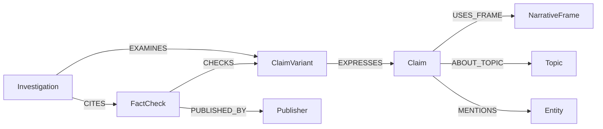

# Graph schema and query behavior

The source model follows [ClaimReview](https://schema.org/ClaimReview), with separate application annotations for narrative context.



| Label | Identity and important fields |
| --- | --- |
| ClaimVariant | SHA-256-derived ID from NFC wording and language; text, normalized_text, language, date; embedding, embedding_model, embedding_revision, embedding_text_sha256 |
| Claim | ID from NFKC/casefold/whitespace-normalized wording and language; canonical_text, equivalence_basis |
| FactCheck | ID from canonical review URL, normalized reviewed claim and language; original URL, verdict, full rating JSON, review date, full source-record JSON, source SHA-256 and index |
| Publisher | ID from publisher domain; source name and attribution basis |
| NarrativeFrame | ID from normalized annotation name; name, description |
| Topic | ID from normalized annotation name; name |
| Entity | ID from normalized name and type; name, type |
| Investigation | Random or request-derived ID; submitted_claim, status, created_at, priority, report_json, review_state, review_note |

`date` on a variant is taken only from the reviewed claim's `itemReviewed.datePublished` when supplied, not from the review date. The complete original dates remain in each FactCheck's source-record JSON. When multiple reviews share a variant, variant properties represent the most recently ingested record; use source records for historical provenance.

All eight labels have ID range indexes. Source ingestion is single-writer, merges by ID, and validation detects duplicate IDs, orphaned reviews and invalid variant-to-canonical-claim cardinality. Investigation nodes now represent actual persisted actions; empty-evidence cases have no fabricated EXAMINES/CITES links.

## Vector retrieval

ClaimVariant.embedding stores a normalized 384-dimensional float32 vector. A native cosine vector index supports `db.idx.vector.queryNodes('ClaimVariant','embedding',k,vecf32($vector))`. In the tested server its `score` is distance (identical vectors return zero), so the application sorts ascending and exposes similarity as `1 - distance`. This behavior has a live regression test.

Each vector records model identity, pinned model revision and text SHA-256. Reads require complete fresh coverage and an operational compatible index. `embed` incrementally updates changed/missing vectors, and adding data requires another embedding pass. No similarity edge is automatically added between retrieved claims; candidate relevance remains a model assessment separate from the curated graph schema.

## Investigation snapshots

The orchestrator stores the dossier as JSON plus searchable action/follow-up properties on Investigation. In one query it links exact existing cited ClaimVariants and FactChecks. No-match cases are persisted without invented claims or reviews. `review_state` tracks human follow-up independently of the original action `status`. Repeating an identical explicit request ID returns its stored snapshot; a new request ID is needed to re-investigate changed data/models.

## Evidence and inference

`CHECKS` and `PUBLISHED_BY` derive from source markup. `EXPRESSES` records conservative exact-normalized-text grouping. `USES_FRAME`, `ABOUT_TOPIC`, and `MENTIONS` come from the separate annotation file and retain `basis=curated_inference`, `reviewed_by`, `rationale`, `source_variant_id` and an entity evidence span where applicable.

Annotations are scoped to canonical claims. They are not coordination claims, and sharing a frame does not make two propositions interchangeable. The supplied annotations disclose AI assistance and pending human review.

## Tested query operations

The executable query source is [src/pehchan/queries.py](../src/pehchan/queries.py). Values are passed through the SDK's parameter dictionary. Labels and relationship names are fixed in code, not derived from user input.

The main narrative traversal is:

```cypher
MATCH p = (v:ClaimVariant {id: $variant_id})-[:EXPRESSES]->(:Claim)
          -[:USES_FRAME]->(frame:NarrativeFrame)<-[:USES_FRAME]-(:Claim)
          <-[:EXPRESSES]-(related:ClaimVariant)
WHERE related.id <> v.id
MATCH (fc:FactCheck)-[:CHECKS]->(related)
MATCH (fc)-[:PUBLISHED_BY]->(pub:Publisher)
RETURN related.id, related.text, frame.name,
       [n IN nodes(p) | n.id], [e IN relationships(p) | type(e)],
       fc.url, fc.verdict_original, pub.name
LIMIT $limit
```

The application also returns provenance for each path edge and the review/publisher IDs. The four path relationships are ordered by traversal; `EXPRESSES` and `USES_FRAME` on the second claim are traversed against their stored direction. Review evidence remains attached to the related variant, never reassigned as a verdict on the submitted claim.

Native [FalkorDB BFS](https://docs.falkordb.com/algorithms/bfs) runs server-side:

```cypher
MATCH (v:ClaimVariant {id: $variant_id})
CALL algo.BFS(v, $depth, null) YIELD nodes, edges
RETURN [n IN nodes | n.id], [e IN edges | type(e)]
```

BFS follows outgoing relationships on the tested server and returns reachable nodes after the starting node. From a variant it reaches its canonical claim and the claim's frame/topic/entities. It does not traverse back down incoming claim edges; the explicit narrative query handles that. BFS's edge list is not a single end-to-end evidence path.

The bounded shortest connection explores `EXPRESSES`, `USES_FRAME`, and `MENTIONS` in either direction, up to eight relationships, orders paths by length, and returns one minimum-length path within that bound. It excludes shared publisher and topic nodes as shortcuts. It is a bounded Cypher path query, not the native `shortestPath` function; this server rejects undirected native shortest-path traversals. BFS satisfies the native graph-algorithm validation.

Entity bridging can connect `variant_700ff916add10df61b609425` to `variant_9e4e7b29e161704389906809` through the explicitly mentioned `5G` entity. That path expresses shared subject matter, not support for either claim or evidence of coordinated circulation.
