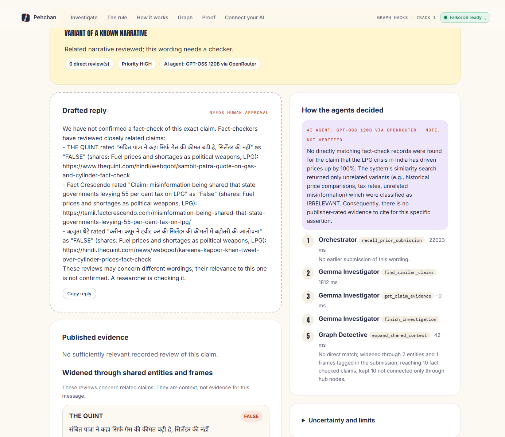
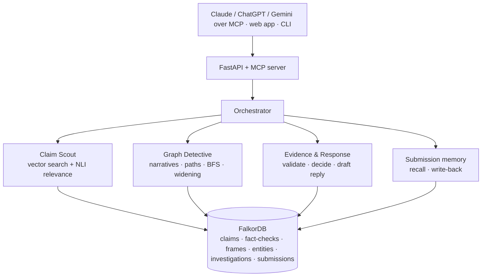
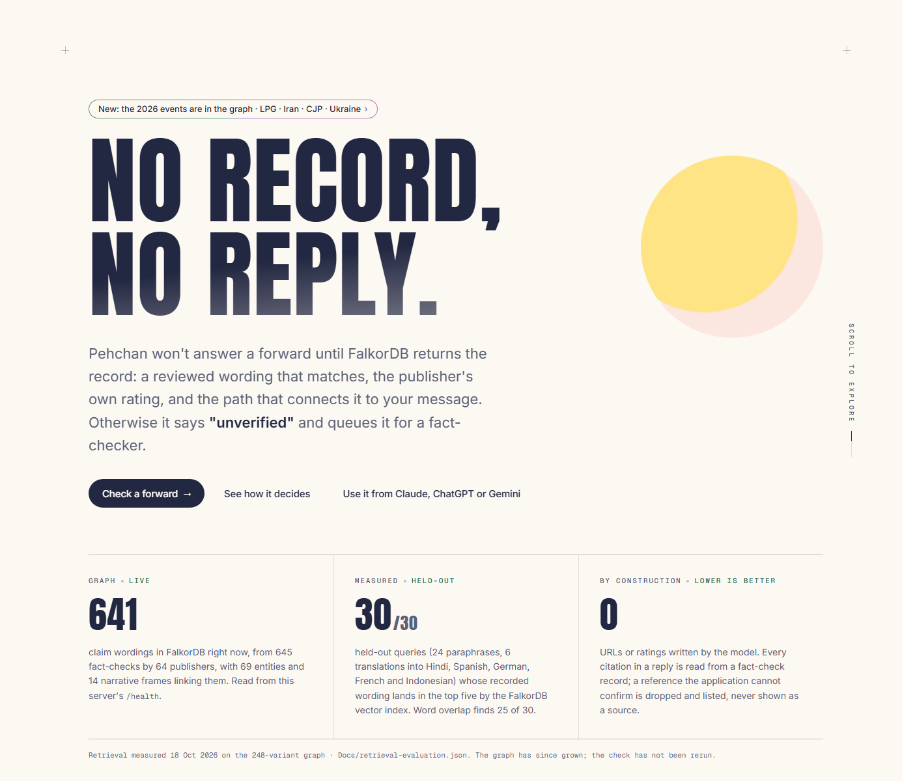
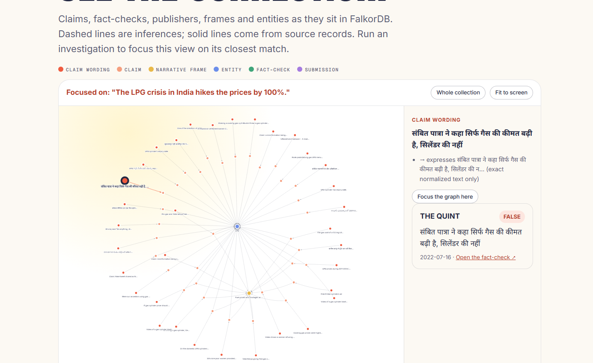

<p align="center"></p>

<h1 align="center">Pehchan: no record, no reply</h1>

<p align="center"><b>An investigation agent that won't answer a forwarded claim until FalkorDB returns the record: a reviewed wording that matches, the publisher's own rating, and the path from that record to the message.</b><br>The model proposes; a read-only graph query decides what counts.</p>

<p align="center">
<a href="https://github.com/harshbpathak/Pehchaan/actions/workflows/ci-cd.yml"></a>
<a href="https://16-192-177-240.sslip.io/"></a>
<a href="compose.yaml"></a>
<a href="#bring-it-into-your-own-ai"></a>
<a href="#check-it-yourself"></a>
<br>


</p>



<p align="center"><b><a href="https://16-192-177-240.sslip.io/">Live demo</a> · <a href="https://16-192-177-240.sslip.io/public/mcp/">Public MCP endpoint</a> · <a href="Docs/retrieval-evaluation.json">The measured numbers</a> · <a href="Docs/Decision.md">Every decision, with its reason</a> · <a href="Docs/Flow.md">Every flow, with its failure branches</a></b></p>

Demo video: _add link before submission_

## The short version

| | |
|---|---|
| **What it is** | An agent for journalists and fact-checkers whose memory and reasoning live in one **FalkorDB** graph: 645 real fact-checks from 64 publishers, their claim wordings, 69 entities, 14 narrative frames, 8 topics, and every message it has investigated. |
| **The rule** | **No record, no reply.** A forward is answered only when the vector index returns a recorded wording and an NLI model agrees in both directions that it is the same claim. Otherwise the agent widens for context, labels it as context, and either queues the message for a human or says "unverified". It never writes a rating or a URL of its own. |
| **What it does** | **Multi-hop proof:** claim → narrative frame or entity → related claim → fact-check → publisher, returned with node ids and relationship types; `algo.SPpaths` connects two claims through an entity bridge in 0.05 s on FalkorDB Cloud. **Graph tools over MCP:** 8 typed tools on an official-SDK Streamable HTTP server, 6 of them public and read-only; the hosted model calls them in a loop with a fixed allow-list, and a call outside it is refused and recorded. **Acts on what the graph shows:** classifies each message (known recycled claim, variant of a known narrative, new), drafts a reply from graph records only, queues new claims, persists an `Investigation` with exact `EXAMINES`/`CITES` edges, and writes the message back as a `Submission` so the next forward of it is answered through a `MATCHES` edge. **Explainable:** every citation carries the publisher URL, the original rating and the path; every inferred edge carries its basis and the text span it came from; the agent timeline states the reason for each step. |
| **FalkorDB depth** | The only store. Native vector index (`db.idx.vector.queryNodes`) over claims and over past submissions; `algo.SPpaths` and `algo.BFS`; fixed parameterised Cypher only, never user text in a query; the agent's memory is nodes and edges in the same graph; remove FalkorDB and nothing answers. |
| **Measured** | Held-out retrieval, 30 queries not in the graph (24 paraphrases, 6 translations): the FalkorDB vector index finds the recorded wording in the top five for **30/30**, word overlap for 25/30, translations 6/6 against 3/6. `algo.SPpaths` returns the four-hop entity bridge in 0.01 s where enumerating paths took 2.1 s. A reworded repeat is answered from the written-back edge in 3.8 s against 32 s for a fresh run (one laptop, CPU). 61 tests pass against a live FalkorDB. Each number says what it was measured on ([The numbers, honestly](#the-numbers-honestly)). |
| **Understand it in five minutes** | [What happens to a message](#what-happens-to-a-message), the [walk-through](#walk-through-it) (a 2026 rumour, a Hindi forward, an entity bridge, a repeat answered from memory, a refusal to guess), the [core Cypher](#core-cypher) and the [graph schema](Docs/graph-schema.md). |
| **Run it** | Live: [16-192-177-240.sslip.io](https://16-192-177-240.sslip.io/) (no account; the "FalkorDB ready" pill shows the live graph size and the model chain). Your agent: paste `https://16-192-177-240.sslip.io/public/mcp/` into Claude, ChatGPT or Gemini ([how](#bring-it-into-your-own-ai)). Your machine: [set up from a clone](#set-up-from-a-fresh-clone). |
| **Stack** | FalkorDB 4.22.1 (pinned by digest) · Python 3.12 and FastAPI · local MiniLM embeddings and DeBERTa NLI · GPT-OSS 120B or Gemma 4 through a provider chain, offline specialists as the disclosed fallback · MCP over Streamable HTTP · a static web app and a Streamlit case desk · Docker Compose on one AWS EC2 VM behind Caddy, deployed by GitHub Actions. |
| **Built for** | Graph Hacks (WeMakeDevs × FalkorDB), **Track 1: Agents That Act on Connected Data** ([bullet by bullet](#track-1-bullet-by-bullet)). |

---

## Try it

| You want to | Do this |
|---|---|
| See it answer a forward | open the [live demo](https://16-192-177-240.sslip.io/) and press "LPG rumour" or "हिन्दी forward", or share a link such as `https://16-192-177-240.sslip.io/?claim=The%20LPG%20crisis%20in%20India%20hikes%20the%20prices%20by%20100%25.` |
| Give your own AI the graph tools | claude.ai or Claude Desktop: Settings → Connectors → Add custom connector → `https://16-192-177-240.sslip.io/public/mcp/`, no authentication. Claude Code: `claude mcp add --transport http pehchan https://16-192-177-240.sslip.io/public/mcp/`. ChatGPT: Developer mode → Create connector → same URL. Gemini CLI: `{"mcpServers": {"pehchan": {"httpUrl": "https://16-192-177-240.sslip.io/public/mcp/"}}}`. Then ask: *"Use Pehchan to check this WhatsApp forward and draft a reply with sources."* |
| Run it on your machine | [Set up from a fresh clone](#set-up-from-a-fresh-clone): Docker for FalkorDB, Python 3.12, two model downloads, one launcher. No API key is needed; without one the offline specialists answer and the page says so. |
| Publish your laptop for a demo | `python scripts/run_public.py` opens a Cloudflare quick tunnel with a read-only public MCP endpoint and generated tokens for writes. |
| Reproduce the numbers | `python scripts/evaluate_retrieval.py` (held-out retrieval), `python scripts/evaluate_semantic.py` (relevance smoke set), `python scripts/smoke_mcp.py` (all tools over HTTP), `PEHCHAN_INTEGRATION=1 pytest -q`. |

## Track 1, bullet by bullet

The five things the track is scored on, where to see each on the live site, and the file behind it.

| Bullet | See it | Behind it |
|---|---|---|
| **Multi-hop reasoning** | run "Known narrative": the detective reaches FactCheck.org and BBC reviews through the `Bill Gates` and `Microchip` entities and a shared frame, each hit listing the nodes it shares; the CLI `path` command returns `variant → claim → Entity(Bill Gates) ← claim ← variant`, four hops across two topics | `src/pehchan/queries.py` (`NARRATIVE_PATHS`, `SHARED_CONTEXT`, `SHORTEST_PATH` with `algo.SPpaths`), `src/pehchan/graph.py` |
| **Graph queries and algorithms as agent tools** | every step in "How the agents decided" names its tool (`find_similar_claims`, `explore_narrative_graph`, `breadth_first_search`, `find_evidence_path`, `expand_shared_context`); the vector index, `algo.BFS` and `algo.SPpaths` are called inside those tools | `src/pehchan/investigation.py` (specialists with fixed tool sets), `src/pehchan/semantic.py` (vector index) |
| **Tool selection through MCP** | the hosted model (GPT-OSS 120B or Gemma 4) chooses the order of calls in a function-calling loop; a call outside its allow-list is refused back to it with what is still required, and the trace records the refusal; the same tools are served over MCP to any client | `src/pehchan/inference.py` (the loop and its guards), `src/pehchan/mcp_server.py` (8 tools, 6 public) |
| **Actions based on what the graph shows** | the finding banner (recycled / narrative variant / new), the drafted reply, the review-queue flag; "Save as case" persists the `Investigation` and writes the `Submission` back; press "Known narrative" twice with a reworded second message and the second run says "Answered from graph memory" | `src/pehchan/investigation.py` (`decide`, `draft_reply`, `CaseStore.link_submission`), `queries.py` (`LINK_SUBMISSION`, `SUBMISSION_SEARCH`) |
| **Explainable results** | each citation shows publisher, original rating, URL and relation; each widened hit shows the shared nodes with the edge's basis and reviewer; click any node in the graph for its connections and the fact-checks behind it; the model's note is shown in its own box, labelled not verified | `src/pehchan/web/assets/app.js`, `Docs/graph-schema.md` |

The rules also say the graph must be load-bearing. It is: retrieval, relevance hand-off, narratives, paths, widening, case records and memory are all FalkorDB reads and writes, and the API returns 503 rather than degrading when the database is unavailable ([ADR-003](Docs/Decision.md)).

## What happens to a message

```text
recall  ── Submission vector index: has this wording been investigated before?
  │          yes, with a direct match → follow its MATCHES edges (no model rerun)
  ▼
scout   ── ClaimVariant vector index + bidirectional NLI relevance
  │
  ├─ direct match ─► detective: narratives · BFS · connection path
  │                  response: re-read publisher evidence → KNOWN_RECYCLED_CLAIM
  │
  └─ no direct match ─► detective widens: entities/frames tagged in the message
                        → fact-checked claims sharing them (rarer nodes weigh more;
                          hub-only and place-only hits dropped)
                        → KNOWN_NARRATIVE_VARIANT or NEW_CLAIM
  ▼
act     ── Investigation (EXAMINES/CITES) · drafted reply · review queue
           Submission -[:MATCHES]-> variant, -[:MENTIONS]-> entity, -[:USES_FRAME]-> frame
```

Every step appears in the report's `agent_trace` with its reason, for example *"No direct match; widened through 2 entities and 1 frames tagged in the submission, reaching 10 fact-checked claims; kept 4 not connected only through hub nodes."* Shared frames and entities are rule-based inferences and are reported as context, never promoted to evidence.



## Four questions, four queries

| Question | How it is decided |
|---|---|
| Has this been fact-checked? | `db.idx.vector.queryNodes` over claim wordings, then NLI in both directions; a record counts only when both agree |
| What narrative is it part of? | `NARRATIVE_PATHS`: claim → frame → related claim → fact-check → publisher, with the basis of every inferred edge; `SHARED_CONTEXT` scores shared entities and frames by `1/degree` |
| How are two claims connected? | `algo.SPpaths` over `EXPRESSES`, `USES_FRAME` and `MENTIONS`, both directions, at most 8 hops; `algo.BFS` for the neighbourhood |
| Have we seen this before? | `db.idx.vector.queryNodes` over `Submission` nodes; a near-identical wording (cosine ≥ 0.95) with a `SAME_PROPOSITION` match is answered through its `MATCHES` edges |

It then takes one action it can show its work for: a drafted reply filled only from records (a person approves it), a review-queue flag, and a case written back into the same graph so the next forward starts warm.

**Pehchan trades reach for safety.** It will not cite a record until the vector index and the NLI model agree, so where a keyword match guesses, it says "variant of a known narrative" or "unverified" and hands the message to a fact-checker. On the Hindi Putin-5G forward the index places the message beside the Dutch, English and French wordings dpa and PolitiFact reviewed, but the English-only NLI model cannot confirm equivalence across languages, so the reply cites those reviews as closely related and the case goes to a human.

## The numbers, honestly

Each number states what it was measured on. The retrieval set is small and author-written; it is a smoke-scale check, not a calibrated accuracy estimate.

| Claim | Pehchan | Compared with | Where |
|---|---|---|---|
| It finds the recorded wording of a reworded or translated forward | hit@5 **30/30** (hit@1 30/30) on 30 held-out queries: 24 paraphrases, 6 translations (Hindi, Spanish, German, French, Indonesian); translations 6/6 | word overlap on the same queries: 25/30, translations 3/6 | [retrieval-evaluation.json](Docs/retrieval-evaluation.json), `scripts/evaluate_retrieval.py`; measured 18 Oct 2026 on the 248-variant graph, not rerun since the 2026 import |
| The graph adds nothing to top-5 retrieval here, and says so | embeddings + graph re-ranking: 30/30, the same as embeddings alone | | same file; the graph's contribution is widening, memory and explanation, not top-5 retrieval |
| Relevance is conservative | 10/11 on the fixed relevance smoke set; the miss is a paraphrase sent to human review rather than a wrong match; both contradiction cases and all distractor and unsupported-language cases pass | | `scripts/evaluate_semantic.py`, [mvp-validation.json](Docs/mvp-validation.json) |
| A native algorithm keeps multi-hop paths fast | `algo.SPpaths` returns the four-hop Bill Gates bridge in **0.01 s** locally and **0.05 s** on FalkorDB Cloud (641 variants) | enumerating variable-length paths and sorting: 2.1 s locally, 4.4 s on the cloud, and a timeout during cloud validation | [ADR-056](Docs/Decision.md) |
| Memory on the graph is faster than rerunning | a reworded repeat answered through the `MATCHES` edge in **3.8 s** | the first run of the same claim: 32 s (laptop CPU, models cold) | [ADR-046](Docs/Decision.md); one run each |
| The model cannot invent a source | citations and case status come only from application checks; a reference the model gives that is not a validated citation is dropped and listed under `inference.dropped_references` | | `src/pehchan/inference.py`, tests in `tests/test_inference.py`; true by construction, not a measurement |
| It keeps working when the hosted model does not | a failed provider hands the rest of the investigation to the next in the chain; when all fail the offline specialists answer and the report says `deterministic_fallback` with the error | | [ADR-050](Docs/Decision.md); live on 18 Oct 2026 AI Studio returned HTTP 500 and OpenRouter completed the run, both recorded in `inference.provider_failures` |
| The code is tested against a real graph | **61 passed** (lint clean) on every push, with a FalkorDB service container in CI; integration tests cover persistence, write-back and recall, widening, refusals and the public endpoint | | [ci-cd.yml](.github/workflows/ci-cd.yml) |

## Screens

<table>
<tr>
<td width="420" valign="top"><br><sub><b>The rule, up front.</b> The status pill reads the live graph size and model chain from <code>/health</code>; the three numbers each say whether they are live, measured or true by construction.</sub></td>
<td width="420" valign="top"><br><sub><b>The investigation desk</b> on "The LPG crisis in India hikes the prices by 100%": no review of that wording exists, so the detective widens through the LPG entity and the fuel-price frame, the reply cites related reviews as context, and the case is queued for a human.</sub></td>
</tr>
<tr>
<td valign="top"><br><sub><b>See the connection.</b> Dashed edges are inferences, solid edges come from source records; click a node for its connections, their basis, and the fact-checks behind it.</sub></td>
<td valign="top"><sub><b>On the live site:</b> the isometric diagram in "How it works" (hover a part for what it does), the proof table, and copy-ready snippets for Claude, ChatGPT and Gemini under "Connect your AI".</sub></td>
</tr>
</table>

## What the rules ask for, answered

| Rule or focus area | What Pehchan does | Where to check |
|---|---|---|
| "FalkorDB must be indispensable", not a visualisation on the side | every retrieval, hand-off, path, widening, case and memory operation is a FalkorDB query; with the database down the API returns 503 and the page says setup is required | `src/pehchan/api.py` (the `RedisError` handler), [ADR-003](Docs/Decision.md) |
| Multi-hop reasoning | four-hop entity bridges, frame paths to publishers, `algo.BFS` neighbourhoods, up to 8 hops in `algo.SPpaths` | [Core Cypher](#core-cypher) |
| Graph queries and algorithms as agent tools | the specialists' tools are the graph methods; the hosted model's six functions wrap them | `src/pehchan/investigation.py`, `src/pehchan/inference.py` |
| Tool selection through MCP | the model picks the call order; the application enforces the allow-list, the required reads and the exact search wording | `tests/test_inference.py` (refusals, budgets, fabricated references) |
| Actions based on graph findings | finding, drafted reply, review queue, persisted case, written-back submission | [ADR-046](Docs/Decision.md) |
| Explainable results | citations with URL, rating and path; edges with basis and span; a timeline with reasons; the model's note kept apart and labelled | the live site, any investigation |
| Ask it something the graph does not know | a claim with nothing related is `NEW_CLAIM`: "We could not find a published fact-check for this claim, and nothing in our graph connects to it yet. Treat it as unverified." | press "Brand new claim" on the live site |

## What is deliberately not here

No truth classifier: Pehchan never rates a claim; it reports who rated which recorded wording. No social-media monitoring, scraping or automatic posting. No OAuth on the MCP endpoint (the public endpoint is read-only without credentials; writes need a token). The relevance model is English-only, so cross-language matches are routed to a human rather than confirmed. Frame and entity tags are keyword rules with their spans, labelled as inferences. The retrieval check is 30 queries. The 2026 event coverage is what the public ClaimReview feed had on 18 October 2026: all LPG and CJP reviews, and samples of 150 each for the Iran and Russia-Ukraine wars.

---

## Walk through it

Run against the live site, or locally with the services started (`scripts/run_local.py`) and the `pehchan` graph.

**A 2026 rumour.** "The LPG crisis in India hikes the prices by 100%." has no review of its exact wording. The agent widens through the shared LPG entity and the fuel-price frame and replies with The Quint and Fact Crescendo reviews of related LPG-price claims, sent for human review.

```powershell
python -m pehchan.cli dossier "The LPG crisis in India hikes the prices by 100%."
# finding: KNOWN_NARRATIVE_VARIANT, status: NEEDS_HUMAN_REVIEW, widening.related with shared nodes and edge provenance
```

**An older version of a claim.** A paraphrase finds the recorded wording, its publisher and rating, and a ready dossier.

```powershell
python -m pehchan.cli dossier "Bill Gates wants to put microchips in people through the covid vaccine."
# status: EVIDENCE_DOSSIER_READY, citations with publisher URLs and original ratings
```

**A Hindi forward matched to existing debunks.** The multilingual index places the message beside the Dutch, English and French wordings dpa and PolitiFact reviewed; the English-only NLI model cannot confirm equivalence, so the case goes to human review with a reply citing those reviews.

```powershell
python -m pehchan.cli dossier "पुतिन ने रूस में 5G पर प्रतिबंध लगा दिया और सभी टावर नष्ट करवा दिए।"
# finding: KNOWN_NARRATIVE_VARIANT, closest wording "Putin bans 5G across Russia…" (PolitiFact: False), similarity 0.90
```

**An entity bridge across topics.** A vaccine-microchip claim and a climate claim connect through `Bill Gates`: a four-hop path that string similarity cannot find.

```powershell
python -m pehchan.cli path variant_d5c3859c252aebe9af62a470 variant_c9ce10f79c7b3a3a9a738cf3
# variant -EXPRESSES-> claim -MENTIONS-> Entity(Bill Gates) <-MENTIONS- claim <-EXPRESSES- variant
```

**The agent changes the graph.** Investigate a claim, then a reworded forward of it. The second run is recalled through the `Submission -[:MATCHES]->` edge written by the first.

```powershell
python -m pehchan.cli investigate "Bill Gates wants to put microchips in people through the covid vaccine." --request-id demo-1
python -m pehchan.cli investigate "Bill Gates wants to put microchips into people through the covid vaccine!" --request-id demo-2
# second report: inference.mode = graph_recall, prior_submission = the first case
```

**A refusal to guess.** An unfamiliar claim has no relevant fact-check and nothing connected, so the system records that instead of manufacturing a verdict.

```powershell
python -m pehchan.cli investigate "Underwater quartz clocks transmit encrypted rainfall forecasts." --request-id demo-c
# finding: NEW_CLAIM, status: INSUFFICIENT_EVIDENCE, queued for review with no invented evidence links
```

## Core Cypher

All queries are fixed and parameterised ([queries.py](src/pehchan/queries.py), [semantic.py](src/pehchan/semantic.py)); no user input becomes a label or query fragment.

Semantic candidates from the native vector index:

```cypher
CALL db.idx.vector.queryNodes('ClaimVariant', 'embedding', $limit, vecf32($vector))
```

Shared-narrative multi-hop traversal to related fact-checks and publishers:

```cypher
MATCH p = (v:ClaimVariant {id: $variant_id})-[:EXPRESSES]->(:Claim)
          -[:USES_FRAME]->(frame:NarrativeFrame)<-[:USES_FRAME]-(:Claim)
          <-[:EXPRESSES]-(related:ClaimVariant)
WHERE related.id <> v.id
MATCH (fc:FactCheck)-[:CHECKS]->(related)
MATCH (fc)-[:PUBLISHED_BY]->(pub:Publisher)
RETURN related.id, related.text, frame.name,
       [n IN nodes(p) | n.id], [e IN relationships(p) | type(e)],
       fc.url, fc.verdict_original, pub.name
LIMIT $limit
```

Widening through shared entities and frames, rarer nodes weighing more:

```cypher
MATCH (n)
WHERE (n:Entity AND n.name IN $entities) OR (n:NarrativeFrame AND n.name IN $frames)
MATCH (n)<-[:MENTIONS|USES_FRAME]-(:Claim)
WITH n, count(*) AS degree
MATCH (n)<-[r:MENTIONS|USES_FRAME]-(c:Claim)<-[:EXPRESSES]-(v:ClaimVariant)
WHERE NOT v.id IN $exclude
WITH v, c, collect({label: labels(n)[0], name: n.name, type: n.type, relation: type(r),
                    basis: r.basis, reviewed_by: r.reviewed_by, evidence_span: r.evidence_span,
                    degree: degree}) AS shared,
     sum(1.0 / degree) AS score
MATCH (fc:FactCheck)-[:CHECKS]->(v)
MATCH (fc)-[:PUBLISHED_BY]->(pub:Publisher)
RETURN v.id, v.text, c.id, shared, score, fc.id, fc.url, fc.verdict_original, fc.review_date, pub.name
ORDER BY score DESC, v.id, fc.id
LIMIT $limit
```

Bounded connection path, including entity bridges, with the native algorithm:

```cypher
MATCH (a:ClaimVariant {id: $from_id}), (b:ClaimVariant {id: $to_id})
CALL algo.SPpaths({sourceNode: a, targetNode: b,
                   relTypes: ['EXPRESSES', 'USES_FRAME', 'MENTIONS'],
                   relDirection: 'both', maxLen: 8, pathCount: 1})
YIELD path
RETURN [n IN nodes(path) | n.id], [e IN relationships(path) | type(e)]
```

Native breadth-first exploration:

```cypher
MATCH (v:ClaimVariant {id: $variant_id})
CALL algo.BFS(v, $depth, null) YIELD nodes, edges
RETURN [n IN nodes | n.id], [e IN edges | type(e)]
```

Memory: recall a past submission, and write one back:

```cypher
CALL db.idx.vector.queryNodes('Submission', 'embedding', $limit, vecf32($vector))
YIELD node, score
OPTIONAL MATCH (i:Investigation)-[:SUBMITTED]->(node)
OPTIONAL MATCH (node)-[m:MATCHES]->(v:ClaimVariant)
RETURN node.id, node.text, score, i.id, i.status, i.finding,
       collect(DISTINCT {variant_id: v.id, text: v.text, relation: m.relation, similarity: m.similarity})
```

Publisher evidence for a variant:

```cypher
MATCH (v:ClaimVariant {id: $variant_id})<-[:CHECKS]-(fc:FactCheck)-[:PUBLISHED_BY]->(pub:Publisher)
RETURN fc.id, fc.url, fc.verdict_original, fc.review_date, pub.name
```

The full schema is in [graph-schema.md](Docs/graph-schema.md).

## Bring it into your own AI

Pehchan is an MCP server. The public endpoint, `/public/mcp/`, is read-only, needs no account, and offers six tools; nothing is saved through it. Writes (`investigate_claim`, `create_review_case`) live on `/mcp/` behind a bearer write token.

| Tool | Effect |
| --- | --- |
| `find_similar_claims` | Semantic candidates, relevance and evidence hand-off |
| `get_claim_evidence` | Original publisher evidence and provenance |
| `explore_narrative_graph` | Explicit shared-frame paths with inference origins |
| `find_evidence_path` | One bounded graph connection, including entity bridges |
| `expand_narrative_context` | Widen through entities/frames tagged in a claim to related fact-checked claims (context only) |
| `assemble_evidence_dossier` | The full read-only investigation |
| `create_review_case` | Persist an explicitly requested human-review case (write token) |
| `investigate_claim` | Run the full workflow and persist its action (write token) |

| Client | How to add Pehchan |
| --- | --- |
| claude.ai / Claude Desktop | Settings → Connectors → Add custom connector → paste `https://16-192-177-240.sslip.io/public/mcp/`, no authentication |
| Claude Code | `claude mcp add --transport http pehchan https://16-192-177-240.sslip.io/public/mcp/` |
| ChatGPT | Settings → Apps & Connectors → Advanced → Developer mode → Create connector → same URL, no authentication |
| Gemini CLI | `~/.gemini/settings.json`: `{"mcpServers": {"pehchan": {"httpUrl": "https://16-192-177-240.sslip.io/public/mcp/"}}}` |

The endpoint is Streamable HTTP, not legacy SSE. All eight tools return structured content and were discovered and called with the official MCP Python client over the public HTTPS URL. Public dossier calls are rate-limited (30 per visitor per 10 minutes by default, `PEHCHAN_PUBLIC_RATE_LIMIT`). Connecting from inside the claude.ai, ChatGPT and Gemini apps has not been tested here. OAuth is not implemented.

For a laptop demo, `python scripts/run_public.py` opens a Cloudflare quick tunnel: it starts a separate API on port 8100 in public read mode with generated tokens, prints the URLs, and stops everything on Ctrl+C.

## Configure the hosted model

Pehchan's agent loop runs an open-weights model through a provider chain that spends as little as possible:

1. **Google AI Studio** (`GEMINI_API_KEY`): Gemma 4 31B on the free tier, with tight per-minute limits.
2. **OpenRouter** (`OPENROUTER_API_KEY`): **GPT-OSS 120B** by default, paid per token ($0.15 per million input, $0.60 per million output; an investigation uses 3-5 tool calls, roughly ₹0.2-0.4).
3. **Offline specialists**: free, local, used and disclosed when every hosted provider fails.

With `PEHCHAN_INFERENCE=auto` (the default) every provider that has a key joins the chain in that order. When a provider fails or is rate-limited mid-investigation, the rest of that investigation continues on the next one; the report records which provider answered (`inference.provider`) and every failure (`inference.provider_failures`). If all fail, the offline specialists answer and the report says `deterministic_fallback` with the error (`PEHCHAN_HOSTED_FALLBACK=0` turns that off). Models are set with `PEHCHAN_GEMINI_MODEL` (default `gemma-4-31b-it`) and `PEHCHAN_OPENROUTER_MODEL` (default `openai/gpt-oss-120b`; `google/gemma-4-31b-it` also works). Keys belong in the backend process environment, never in chat or tracked files; Python does not load `.env`.

```powershell
# Read keys without displaying them or recording them as command literals.
$k = Read-Host "OpenRouter key" -AsSecureString
$env:OPENROUTER_API_KEY = [System.Net.NetworkCredential]::new('', $k).Password
Remove-Variable k
.\.tools\python\python.exe scripts/run_local.py
.\.tools\python\python.exe scripts/smoke_inference.py --claim "A claim you have not submitted before"
```

Restart a running backend from that environment; the launcher leaves healthy processes alone. `/health` shows the chain and whether keys are present (presence is not proof of access).

Live runs on 18 October 2026: AI Studio's Gemma 4 31B returned HTTP 500 even for a one-line prompt, then 429 once the free per-minute quota was used; OpenRouter's GPT-OSS 120B completed the LPG, Hindi Putin-5G and vaccine-microchip claims in 3-5 tool calls each. Model behaviour is constrained in code: the search tool takes no arguments (the application always searches the exact submitted wording, after models degenerated retyping Devanagari text); out-of-scope reads are refused back to the model with what is still required; references the application cannot confirm are dropped and listed. The model receives the submitted claim and selected retrieved evidence over HTTPS; raw ClaimReview markup and file provenance stay local. Its note is labelled model commentary.

To run the offline workflow only, set `PEHCHAN_INFERENCE=deterministic` before starting the backend or CLI.

## Set up from a fresh clone

Use Python 3.12 for the tested pinned environment, Docker's Linux engine, and enough disk and RAM for PyTorch and the two local model checkpoints (about 3-4 GB of RAM). The package targets Python 3.11+, but other interpreters may need their own dependency resolution.

Windows PowerShell, with no activation-script requirement:

```powershell
python -m venv .venv
$taskPython = ".\.venv\Scripts\python.exe"
& $taskPython -m pip install "torch==2.14.1" --index-url https://download.pytorch.org/whl/cpu
& $taskPython -m pip install -c requirements.lock -e ".[semantic,server,ui,dev]"
docker compose up -d --wait
& $taskPython scripts/validate_demo.py
& $taskPython -m pehchan.cli download-models
& $taskPython -m pehchan.cli --graph pehchan_demo embed
$env:FALKORDB_GRAPH = "pehchan_demo"
& $taskPython scripts/run_local.py
```

On macOS/Linux, create and activate the virtual environment normally, use `python` in place of `& $taskPython`, and `export FALKORDB_GRAPH=pehchan_demo`. The included sample gives a stable 12-review demo; the full collection is built by [Import the feed](#import-the-feed). Then open:

- Web app: [http://localhost:8000](http://localhost:8000) (investigation desk, graph explorer, MCP connection guide)
- Streamlit case desk: [http://localhost:8501](http://localhost:8501) (saved cases and follow-up)
- API documentation: [http://localhost:8000/docs](http://localhost:8000/docs)
- MCP transport: `http://localhost:8000/mcp/`
- Database browser: [http://localhost:3000](http://localhost:3000)

The launcher uses background processes, leaves healthy existing services running, and writes logs under `artifacts/`. For foreground logs run the two services yourself:

```text
python -m uvicorn pehchan.api:app --host 127.0.0.1 --port 8000 --workers 1
python -m streamlit run src/pehchan/ui.py --server.address 127.0.0.1 --server.port 8501 --server.headless true --browser.gatherUsageStats false
```

One API worker serialises local model work and graph actions.

**Hosting.** The live instance is one AWS EC2 VM set up by [deploy/ec2/setup.sh](deploy/ec2/setup.sh) and updated by GitHub Actions on every tested push to `main` ([Docs/Deployment.md](Docs/Deployment.md)). A Hugging Face Space + FalkorDB Cloud setup is also included; `scripts/load_graph.py` fills any FalkorDB, including FalkorDB Cloud, from the prepared datasets.

## Import the feed

The [Data Commons download page](https://datacommons.org/factcheck/download) links the official current ClaimReview feed. To build the graph from a new download (the feed changes over time):

```powershell
New-Item -ItemType Directory -Force data/raw | Out-Null
curl.exe --fail --location https://storage.googleapis.com/datacommons-feeds/claimreview/latest/data.json --output data/raw/claimreview-latest.json
python -m pehchan.cli prepare data/raw/claimreview-latest.json --output data/processed/claims.jsonl --report data/processed/preparation-report.json --source https://storage.googleapis.com/datacommons-feeds/claimreview/latest/data.json --contains microchip --contains 5g --contains "climate change" --contains "moon landing" --limit 250
python scripts/annotate_collection.py data/processed/claims.jsonl
python -m pehchan.cli --graph pehchan ingest data/processed/claims.jsonl --annotations data/annotations/collection.json
python -m pehchan.cli --graph pehchan validate data/processed/claims.jsonl --require-narrative --output artifacts/validation.json
```

The 2026 event reviews were added with the same commands, one subset per topic, then merged, tagged and embedded:

```powershell
python -m pehchan.cli prepare data/raw/claimreview-latest.json --output data/processed/events-lpg.jsonl --report data/processed/events-lpg-report.json --source <feed URL> --contains lpg --contains "cooking gas" --contains "gas cylinder" --contains "एलपीजी" --contains "सिलेंडर"
# likewise: --contains cjp --contains "cockroach jan"; --contains iran --limit 150; --contains ukrain --limit 150
# merge the four files into data/processed/events.jsonl (deduplicated by factcheck_id), then:
python scripts/annotate_collection.py data/processed/events.jsonl --output data/annotations/events.json
python -m pehchan.cli --graph pehchan ingest data/processed/events.jsonl --annotations data/annotations/events.json
python -m pehchan.cli --graph pehchan embed
```

`--contains` performs OR substring selection, not topic classification; `--limit` caps accepted unique reviews. Twelve claims carry hand-inspected annotations ([sample](data/samples/annotations.json)); the rest are annotated by explicit keyword rules ([annotator](scripts/annotate_collection.py), [rules](src/pehchan/rules.py)). Every entity carries a span quoted from the claim text. Rule annotations are inferences awaiting human review. Run `embed` again after expanding the collection; already fresh vectors are skipped.

The graph after both imports:

| Records | Count |
| --- | ---: |
| FactCheck | 645 |
| ClaimVariant / Claim | 641 each |
| Publisher | 64 |
| NarrativeFrame / Topic / Entity | 14 / 8 / 69 |
| USES_FRAME / ABOUT_TOPIC / MENTIONS | 400 / 643 / 944 |

Two pairs of fact-checks review identical claim wording, so the counts of reviews and variants differ. Both datasets pass `validate --require-narrative` locally and on FalkorDB Cloud.

## Day to day

```powershell
python -m pehchan.cli scout "Coronavirus is being spread by 5G technology."
python -m pehchan.cli investigate "Underwater quartz clocks transmit encrypted rainfall forecasts." --request-id researcher-example-1
python -m pehchan.cli cases
python -m pehchan.cli dossier "Scientists have had to pause the Climate Change Hoax Scam"
python -m pehchan.cli embedding-status
python -m pehchan.cli semantic-search "Coronavirus is being spread by 5G technology."
python -m pehchan.cli --graph pehchan_demo path variant_700ff916add10df61b609425 variant_9e4e7b29e161704389906809
python -m pehchan.cli --graph pehchan_demo bfs variant_700ff916add10df61b609425
```

`dossier` assembles without saving; `investigate` persists. The optional request ID deduplicates identical retries and rejects reuse for another claim. `review CASE_ID --state IN_PROGRESS --note "Checking sources"` changes follow-up, not the evidence decision. The original `search` command is the explicit lexical baseline; every one of its results is an unverified candidate.

**Access control.** Local listeners are loopback-only by default. Set `PEHCHAN_API_TOKEN` for read access and a distinct `PEHCHAN_WRITE_TOKEN` for case writes; the combined `/mcp/` endpoint requires the write credential when tokens are configured. `PEHCHAN_PUBLIC_READ=1` opens the page, the read-only routes and `/public/mcp/` without credentials. Public-host configuration requires distinct credentials. Host and Origin checks are enabled. There is no arbitrary-Cypher or ingestion HTTP tool. Connection settings are in [.env.example](.env.example); `.env` is not loaded automatically.

## Data guarantees and current limits

- Readers accept ClaimReview JSON objects, arrays, JSON-LD `@graph`, DataFeed items, JSONL/NDJSON, and gzip versions. DataFeed input is streamed.
- Stable IDs separate exact wording, conservatively normalised claims, source reviews, and publisher domains. Punctuation, negation, and numbers remain in canonical text; similar claims are not automatically merged.
- Original markup, rating objects including numeric scales, URLs, source-file SHA-256, record indices, licences when supplied, and review dates are retained. Missing dates remain missing. `itemReviewed.author` is never used as the fact-check publisher.
- Invalid required fields are audited as rejections. Identical source reviews are deduplicated. Conflicting ratings for the same URL and claim abort preparation and preserve any previous output.
- All prepared records and annotations are validated before graph writes. `MERGE` and ID indexes support reruns. Each review is written atomically; a failed import can be rerun. Reingestion merges records; it does not clear existing data.
- Vectors use the pinned multilingual MiniLM model; relevance uses pinned English DeBERTa NLI in both directions. Unsupported languages or overlong NLI pairs are explicitly uncertain. Missing or stale embeddings fail rather than falling back silently.
- Removing FalkorDB breaks retrieval, relationships, path queries, memory and validation. There is no fallback graph or mocked query result.

## Check it yourself

```powershell
$env:PEHCHAN_INTEGRATION = "1"
$env:PEHCHAN_MODELS = "1"
python -m pytest -q
python -m ruff check .
python scripts/evaluate_retrieval.py --graph pehchan
python scripts/evaluate_semantic.py --graph pehchan
python scripts/smoke_mcp.py
python scripts/verify_mvp.py
```

On macOS/Linux export the variables instead. Integration tests create uniquely named `pehchan_test_*` graphs and delete only those graphs afterwards. The last full run: **61 passed**, Ruff clean, against a live FalkorDB and the real local models. GitHub Actions runs the same lint and tests with a FalkorDB service container on every push, then deploys `main` to the EC2 host when it passes. The [decision register](Docs/Decision.md) records what was chosen and why; the [flow register](Docs/Flow.md) describes every command, data path and failure branch.

## Attribution

The dataset compilation is credited to Data Commons / Google Fact Check Tools and the publishers identified in each record. Compilation licensing and publisher-content licensing are distinct; see [the source's licensing notes](https://datacommons.org/factcheck/download) and [sample manifest](data/samples/manifest.json). This repository contains selected structured markup, not downloaded article bodies. The implementation and sample annotations were produced with Codex AI coding assistance. Collection-wide rule annotations, the hosted-model chain and fallback, structured MCP results, graph widening, outcome classification and drafted replies, submission write-back and recall, the 2026 event import, the held-out evaluation queries, the web app, the deployment scripts and pipeline, and this README were produced with Claude Code (Anthropic) assistance. The web app's component patterns (status pill, numbers row, figure cards, isometric diagram) are adapted from the open-source [Faultline](https://github.com/Prashant-thakur77/Faultline) front end.
