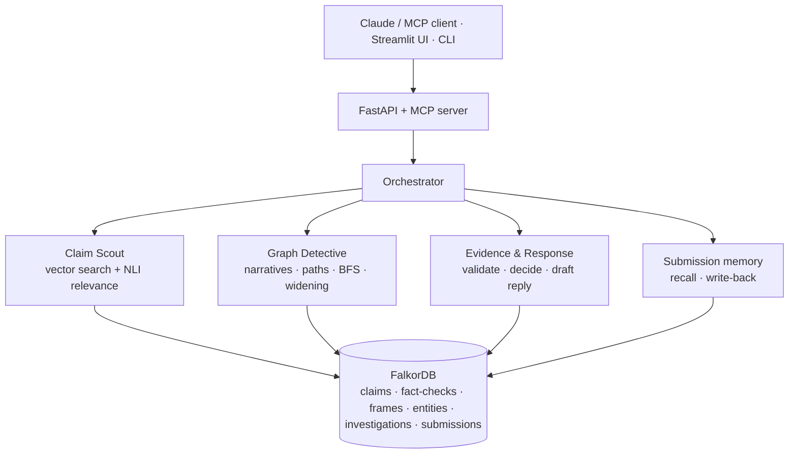

<p align="center"></p>

<h1 align="center">Pehchan AI</h1>

<p align="center"><b>Graph-native misinformation investigation: local semantic retrieval, cooperating specialists, traceable publisher evidence and persistent review cases, all on one FalkorDB graph.</b></p>

<p align="center">
<a href="https://github.com/harshbpathak/Pehchaan/actions/workflows/ci-cd.yml"></a>
<a href="https://16-192-177-240.sslip.io/"></a>
<a href="compose.yaml"></a>
<a href="#mcp-and-access-control"></a>


</p>


<p align="center"><b><a href="https://16-192-177-240.sslip.io/">Live demo</a> · <a href="https://16-192-177-240.sslip.io/public/mcp/">Public MCP endpoint</a> · <a href="Docs/Decision.md">Decision register</a> · <a href="Docs/Flow.md">Flow register</a></b></p>

**WeMakeDevs × FalkorDB Graph Hacks — Track 1: Agents That Act on Connected Data**

> Demo video: _add link before submission_

## In one table

| | |
|---|---|
| **Who it is for** | Journalists, fact-checkers and researchers who receive a forwarded claim and need to know, fast, whether it has been reviewed before and what it connects to. |
| **What it keeps in FalkorDB** | 645 real ClaimReview fact-checks from 64 publishers, their claim wordings, 69 entities, 14 narrative frames, 8 topics, every saved investigation, and every submitted message with the edges the agent established for it. |
| **How it decides** | A native vector index finds recorded wordings by meaning; an NLI model has to agree in both directions before one counts as a match. Without a match the Graph Detective widens through shared entities and frames, and reports that as context. The application, not the model, chooses the case status and every citation. |
| **What it does with the answer** | Classifies the message (known recycled claim, variant of a known narrative, new), drafts a reply from graph records only, queues new claims for a human, persists the case with exact `EXAMINES`/`CITES` edges, and writes the message back so a repeat forward is answered through a `MATCHES` edge. |
| **How you can use it** | The web app, the CLI, or eight MCP tools over Streamable HTTP; six of them are public and read-only, so Claude, ChatGPT and Gemini can call the same graph. |
| **What was measured** | Held-out retrieval 30/30 by the vector index against 25/30 for word overlap; `algo.SPpaths` returns a four-hop entity bridge in 0.01 s locally; a repeat forward is answered from memory in about 4 s against about 30 s cold; 61 tests pass against a live FalkorDB. Details and limits below. |

A journalist asks: *"I've seen a claim that vaccines contain tracking microchips. Has something like it been fact-checked? Which narratives connect to it, and should it be reviewed?"* Pehchan finds previously fact-checked wordings, traverses FalkorDB to the narratives, entities and publishers around them, and decides whether a source-backed dossier is ready or the case needs a human. It never invents a truth verdict: ratings always belong to the original publisher, and missing evidence is reported as missing.

## Hosting

- **Permanent (recommended):** AWS EC2 set up by one script (`deploy/ec2/setup.sh`) and updated by GitHub Actions on every tested push to `main`. Steps: [Docs/Deployment.md](Docs/Deployment.md#aws-ec2-with-one-command-setup-and-cicd-recommended-permanent-hosting). A Hugging Face Space + FalkorDB Cloud setup is also included.
- **Quick demo from a laptop:** `scripts/run_public.py` (Cloudflare quick tunnel), below.

## Use it from Claude, ChatGPT or Gemini

Pehchan is an MCP server. Its public endpoint, `/public/mcp/`, is read-only, needs no account, and offers six tools: search, evidence, narrative paths, connection paths, widening and full dossiers. Nothing is saved through it. Writes (`investigate_claim`, `create_review_case`) live on `/mcp/` behind a bearer write token.

Publish this laptop's instance through a Cloudflare quick tunnel (no Cloudflare account needed; cloudflared is downloaded on first run):

```powershell
.\.tools\python\python.exe scripts/run_public.py
```

It prints the public web page and MCP URL, starts a separate API on port 8100 in public read mode with generated tokens, and stops everything on Ctrl+C. The URL changes on every run and works only while the laptop is on. Then:

| Client | How to add Pehchan |
| --- | --- |
| claude.ai / Claude Desktop | Settings → Connectors → Add custom connector → paste `https://<tunnel>/public/mcp/`, no authentication |
| Claude Code | `claude mcp add --transport http pehchan https://<tunnel>/public/mcp/` |
| ChatGPT | Settings → Apps & Connectors → Advanced → Developer mode → Create connector → same URL, no authentication |
| Gemini CLI | `~/.gemini/settings.json`: `{"mcpServers": {"pehchan": {"httpUrl": "https://<tunnel>/public/mcp/"}}}` |

The web page at the same address has the investigation desk, the graph explorer, and copy-ready connection snippets for its own URL. Public dossier calls are rate-limited (30 per visitor per 10 minutes by default, `PEHCHAN_PUBLIC_RATE_LIMIT`). If a Gemini key is configured, public dossiers use it, so leave the key unset for a public demo or accept the quota use.

Verified on the live tunnel with the official MCP Python client: tool discovery returned the six read-only tools, and a dossier call matched "Putin has banned 5G in Russia…" to PolitiFact's review. Connecting from the claude.ai, ChatGPT and Gemini apps themselves has not been tested here.

## How Pehchan meets Track 1

| Track 1 focus | Implementation |
| --- | --- |
| Multi-hop reasoning | `ClaimVariant → Claim → NarrativeFrame/Entity → Claim → ClaimVariant ← FactCheck → Publisher`, returned with node IDs and relationship types |
| Graph queries and algorithms as agent tools | Native FalkorDB vector index (`db.idx.vector.queryNodes`), parameterized narrative/evidence Cypher, bounded variable-length path search, native `algo.BFS` |
| Tool selection through MCP | 8 typed tools with output schemas on an official-SDK Streamable HTTP MCP server; Gemma chooses tools in a function-calling loop; the orchestrator widens through shared entities/frames only when no direct match exists |
| Actions based on graph findings | Classifies each message as a known recycled claim, a variant of a known narrative, or new; drafts a reply citing only graph records; queues new claims for review; persists an `Investigation` with exact `EXAMINES`/`CITES` edges; writes the message back as a `Submission` node linked by `MATCHES`/`MENTIONS`/`USES_FRAME`, so a repeat forward is answered through those edges |
| Explainable results | Every citation carries the publisher URL, original rating and graph path; inferred links carry their basis and evidence span |

FalkorDB is indispensable: retrieval, evidence, narratives, paths, BFS and case records all execute in the graph. There is no fallback store.



The graph holds 645 real ClaimReview records (641 claim variants, 64 publishers) in 8 topics, linked to 14 narrative frames and 69 entities. Beyond the original COVID-19/5G, vaccine-microchip, climate and moon-landing seed, it covers the 2026 events on the landing page: the LPG crisis (48 reviews), the CJP protest (48), the Iran war (150) and the Russia-Ukraine war (150), imported from the same feed. Wordings are multilingual.

## What the agent does with a new message

```text
recall  ── Submission vector index: has this wording been investigated before?
  │          yes, with a direct match → follow its MATCHES edges (no model rerun)
  ▼
scout   ── ClaimVariant vector index + bidirectional NLI relevance
  │
  ├─ direct match ─► detective: narratives · BFS · connection path
  │                  response: re-read publisher evidence → KNOWN_RECYCLED_CLAIM
  │
  └─ no direct match ─► detective widens: entities/frames tagged in the message
                        → fact-checked claims sharing them (rarer nodes weigh more,
                          hub-only hits dropped) → KNOWN_NARRATIVE_VARIANT or NEW_CLAIM
  ▼
act     ── Investigation (EXAMINES/CITES) · drafted reply · review queue
           Submission -[:MATCHES]-> variant, -[:MENTIONS]-> entity, -[:USES_FRAME]-> frame
```

Every step appears in the report's `agent_trace` with its reason (for example *"No direct match; widened through 2 entities and 1 frames…"*). Shared frames and entities are rule-based inferences and are reported as context, never promoted to evidence.

## Demonstrations

Run with the services started (`scripts/run_local.py`) against the `pehchan` graph.

**A0 — A 2026 rumour.** "The LPG crisis in India hikes the prices by 100%." has no review of its exact wording. The agent widens through the shared LPG entity and the fuel-price frame and replies with The Quint and Fact Crescendo reviews of related LPG-price claims, sent for human review. A claim with nothing related gets the new-claim reply: treat it as unverified, do not forward it until confirmed.

**A — An older version of a claim.** A new paraphrase finds the recorded wording, its publisher and rating, and a ready dossier.

```powershell
python -m pehchan.cli dossier "Bill Gates wants to put microchips in people through the covid vaccine."
# status: EVIDENCE_DOSSIER_READY, citations with publisher URLs and original ratings
```

**B — An entity bridge across topics.** A vaccine-microchip claim and a climate claim connect through the shared `Bill Gates` entity: a four-hop path that string similarity cannot find.

```powershell
python -m pehchan.cli path variant_d5c3859c252aebe9af62a470 variant_c9ce10f79c7b3a3a9a738cf3
# variant -EXPRESSES-> claim -MENTIONS-> Entity(Bill Gates) <-MENTIONS- claim <-EXPRESSES- variant
```

**A2 — A Hindi forward matched to existing debunks.** The multilingual vector index places a Hindi message beside the Dutch, English and French wordings that dpa and PolitiFact reviewed. The English-only NLI model cannot confirm relevance across languages, so the case goes to human review with a reply citing those reviews.

```powershell
python -m pehchan.cli dossier "पुतिन ने रूस में 5G पर प्रतिबंध लगा दिया और सभी टावर नष्ट करवा दिए।"
# finding: KNOWN_NARRATIVE_VARIANT, closest wording "Putin bans 5G across Russia…" (PolitiFact: False), similarity 0.90
```

**A3 — The agent changes the graph.** Investigate a claim, then a slightly reworded forward of it. The second run is recalled through the `Submission -[:MATCHES]->` edge written by the first, skipping retrieval and relevance models (about 4 s instead of about 30 s on a laptop CPU in our run).

```powershell
python -m pehchan.cli investigate "Bill Gates wants to put microchips in people through the covid vaccine." --request-id demo-a3-1
python -m pehchan.cli investigate "Bill Gates wants to put microchips into people through the covid vaccine!" --request-id demo-a3-2
# second report: inference.mode = graph_recall, prior_submission = the first case
```

**B2 — Widening when nothing matches directly.** A new wording of a known narrative has no direct match. The detective widens through the `Bill Gates` and `Microchip` entities and a shared frame, reaching FactCheck.org and BBC reviews of related claims.

```powershell
python -m pehchan.cli dossier "Bill Gates secretly funds a plan to track everyone with implanted chips."
# finding: KNOWN_NARRATIVE_VARIANT, status: NEEDS_HUMAN_REVIEW, widening.related with shared nodes and edge provenance
```

**C — An autonomous decision not to guess.** An unfamiliar claim has no relevant fact-check, so the system records that instead of manufacturing a verdict.

```powershell
python -m pehchan.cli investigate "Underwater quartz clocks transmit encrypted rainfall forecasts." --request-id demo-c
# finding: NEW_CLAIM, status: INSUFFICIENT_EVIDENCE, queued for review with no invented evidence links
```

## Held-out retrieval check

[evaluate_retrieval.py](scripts/evaluate_retrieval.py) runs 30 author-written queries (24 paraphrases, 6 translations into Hindi, Spanish, German, French and Indonesian) that are not stored in the graph. A hit is any recorded wording of the same claim in the top k. Settings were fixed before the run. Results are in [retrieval-evaluation.json](Docs/retrieval-evaluation.json).

| Method | hit@1 | hit@5 | Translations hit@5 |
| --- | ---: | ---: | ---: |
| Word overlap | 25/30 | 25/30 | 3/6 |
| Embeddings (FalkorDB vector index) | 30/30 | 30/30 | 6/6 |
| Embeddings + graph widening | 30/30 | 30/30 | 6/6 |

On this set, embeddings already retrieve every case, so graph re-ranking adds nothing to top-5 retrieval. The graph's measured contribution is elsewhere: widening when no direct review exists (B2), recall through written-back edges (A3), and the evidence paths in every report. Thirty queries over 248 variants is a smoke-scale check, not a calibrated accuracy estimate.

## Core Cypher

All queries are fixed and parameterized ([queries.py](src/pehchan/queries.py), [semantic.py](src/pehchan/semantic.py)); no user input becomes a label or query fragment.

Semantic candidates from the native vector index:

```cypher
CALL db.idx.vector.queryNodes('ClaimVariant', 'embedding', $limit, vecf32($vector))
```

Shared-narrative multi-hop traversal to related fact-checks and publishers:

```cypher
MATCH p = (v:ClaimVariant {id: $variant_id})-[:EXPRESSES]->(:Claim)
          -[:USES_FRAME]->(frame:NarrativeFrame)<-[:USES_FRAME]-(:Claim)
          <-[:EXPRESSES]-(related:ClaimVariant)
WHERE related.id <> v.id
MATCH (fc:FactCheck)-[:CHECKS]->(related)
MATCH (fc)-[:PUBLISHED_BY]->(pub:Publisher)
RETURN related.id, related.text, frame.name,
       [n IN nodes(p) | n.id], [e IN relationships(p) | type(e)],
       fc.url, fc.verdict_original, pub.name
LIMIT $limit
```

Bounded connection path, including entity bridges:

```cypher
MATCH (a:ClaimVariant {id: $from_id}), (b:ClaimVariant {id: $to_id})
CALL algo.SPpaths({sourceNode: a, targetNode: b,
                   relTypes: ['EXPRESSES', 'USES_FRAME', 'MENTIONS'],
                   relDirection: 'both', maxLen: 8, pathCount: 1})
YIELD path
RETURN [n IN nodes(path) | n.id], [e IN relationships(path) | type(e)]
```

`algo.SPpaths` replaced an enumerate-and-sort variable-length match: the same path in 0.01 s instead of 2.1 s on the 641-variant graph.

Native breadth-first exploration:

```cypher
MATCH (v:ClaimVariant {id: $variant_id})
CALL algo.BFS(v, $depth, null) YIELD nodes, edges
RETURN [n IN nodes | n.id], [e IN edges | type(e)]
```

Publisher evidence for a variant:

```cypher
MATCH (v:ClaimVariant {id: $variant_id})<-[:CHECKS]-(fc:FactCheck)-[:PUBLISHED_BY]->(pub:Publisher)
RETURN fc.id, fc.url, fc.verdict_original, fc.review_date, pub.name
```

The full schema is in [graph-schema.md](Docs/graph-schema.md).

## How it works

The local MVP imports real ClaimReview records, embeds claims in FalkorDB, assesses textual relevance, traces connected narratives, assembles dossiers and records the recommended action. A FastAPI service, eight real Streamable HTTP MCP tools and a Streamlit interface use the same investigation logic.

With a Google AI Studio key configured, investigation uses Gemma tool-calling inference (`PEHCHAN_INFERENCE=auto`, the default); without a key it runs the offline specialists, so a fresh clone works without credentials. Gemma selects local semantic retrieval, source evidence and graph tools; local embedding/NLI models still assess relevance. Application code validates citations and selects the final case status. Publisher ratings remain attached to their original reviewed claims. An explicit deterministic mode retains the earlier offline specialist workflow.

## Configure Gemma inference

Pehchan's agent loop runs on **Gemma 4 31B**, Google's open-weights model, through a provider chain that spends as little as possible:

1. **Google AI Studio** (`GEMINI_API_KEY`): free tier, tight per-minute limits.
2. **OpenRouter** (`OPENROUTER_API_KEY`): open-weights **GPT-OSS 20B** by default with low reasoning effort, paid per token ($0.018 per million input, $0.09 per million output; an investigation uses 2-5 tool calls and finishes in about 12-18 s).
3. **Offline specialists**: free, local, used and disclosed when every hosted provider fails.

With `PEHCHAN_INFERENCE=auto` (default) every provider that has a key joins the chain in that order. When a provider fails or is rate-limited mid-investigation, the rest of that investigation continues on the next one; the report records which provider answered (`inference.provider`) and every failure (`inference.provider_failures`). If all fail, the offline specialists answer and the report says `deterministic_fallback` with the error (`PEHCHAN_HOSTED_FALLBACK=0` turns that off). Models are set with `PEHCHAN_GEMINI_MODEL` (default `gemma-4-31b-it`) and `PEHCHAN_OPENROUTER_MODEL` (default `openai/gpt-oss-20b`; `openai/gpt-oss-120b` and `google/gemma-4-31b-it` also work). `PEHCHAN_OPENROUTER_REASONING` (default `low`) sets the reasoning effort for models that think before each tool call. Keys belong in the backend process environment, never in chat or tracked files; Python does not load `.env`.

```powershell
# Read keys without displaying them or recording them as command literals.
$k = Read-Host "Google AI Studio key" -AsSecureString
$env:GEMINI_API_KEY = [System.Net.NetworkCredential]::new('', $k).Password
$k = Read-Host "OpenRouter key (optional)" -AsSecureString
$env:OPENROUTER_API_KEY = [System.Net.NetworkCredential]::new('', $k).Password
Remove-Variable k
.\.tools\python\python.exe scripts/run_local.py
.\.tools\python\python.exe scripts/smoke_inference.py --claim "A claim you have not submitted before"
```

Restart a running backend from that environment; the launcher leaves healthy processes alone. `/health` shows the chain and whether keys are present (presence is not proof of access).

Live runs on 18 October 2026: AI Studio's Gemma 4 31B returned HTTP 500 (even for a one-line prompt) and then 429 after our tests used the free per-minute quota, while Gemma 4 26B answered. On OpenRouter, timed on the Hindi Putin-5G forward: GPT-OSS 120B took 48 s with low reasoning effort and 112 s without, Gemma 4 31B 24 s, GPT-OSS 20B 14 s; the 20B model then gave the same findings as the 120B on the LPG, vaccine-microchip, 5G-coronavirus and nonsense claims in 12-18 s each, so it is the default. Expect the free AI Studio tier to be intermittent; the chain and the disclosed fallback keep investigations answering.

Model behaviour is constrained in code: the search tool takes no arguments (the application always searches the exact submitted wording, after models degenerated retyping Devanagari text); out-of-scope reads are refused back to the model with what is still required; references the application cannot confirm are dropped and listed. Gemma receives the submitted claim and selected retrieved evidence over HTTPS; raw ClaimReview markup and file provenance stay local. Analyst notes are labelled model commentary.

To run the original offline workflow, explicitly set `$env:PEHCHAN_INFERENCE = "deterministic"` before starting the backend/CLI. Local models and graph setup are still required. Install `.[llm]` for CLI-only LLM use; the server extra already includes its HTTP dependency. The tool loop uses the documented `generateContent` REST API with no additional SDK dependency.

## Open the running MVP

- Web app: [http://localhost:8000](http://localhost:8000) (investigation desk, graph explorer, MCP connection guide)
- Streamlit case desk: [http://localhost:8501](http://localhost:8501) (saved cases and follow-up)
- API documentation: [http://localhost:8000/docs](http://localhost:8000/docs)
- MCP transport: `http://localhost:8000/mcp/`
- Database browser: [http://localhost:3000](http://localhost:3000)

This workspace has the 250-review main collection, 248 indexed variants, downloaded models and saved demo investigations. Start its API/UI with:

```powershell
.\.tools\python\python.exe scripts/run_local.py
```

The launcher uses background processes, leaves healthy existing services running, and writes logs under `artifacts/`. It does not change PowerShell execution policy.

## Set up the complete MVP from a fresh clone

Use Python 3.12 for the tested pinned environment, Docker's Linux engine, and enough disk/RAM for PyTorch and the two local model checkpoints. The package code targets Python 3.11+, but other interpreters may need compatible dependency resolution rather than this exact constraints snapshot. Retrieval/NLI uses local checkpoints; default Gemma inference additionally requires network access and an AI Studio key configured above.

Windows PowerShell, with no activation-script requirement:

```powershell
python -m venv .venv
$taskPython = ".\.venv\Scripts\python.exe"
& $taskPython -m pip install "torch==2.14.1" --index-url https://download.pytorch.org/whl/cpu
& $taskPython -m pip install -c requirements.lock -e ".[semantic,server,ui,dev]"
docker compose up -d --wait
& $taskPython scripts/validate_demo.py
& $taskPython -m pehchan.cli download-models
& $taskPython -m pehchan.cli --graph pehchan_demo embed
$env:FALKORDB_GRAPH = "pehchan_demo"
& $taskPython scripts/run_local.py
```

On macOS/Linux, create/activate the virtual environment normally, use `python` in place of `& $taskPython`, and `export FALKORDB_GRAPH=pehchan_demo`. The included sample gives a stable 12-review demo; the larger feed import below is optional. The database must already be running before the application becomes ready.

For foreground service logs instead of the launcher:

```text
python -m uvicorn pehchan.api:app --host 127.0.0.1 --port 8000 --workers 1
python -m streamlit run src/pehchan/ui.py --server.address 127.0.0.1 --server.port 8501 --server.headless true --browser.gatherUsageStats false
```

Run these in separate terminals with the same graph/model/token environment. One API worker serializes local model work and graph actions.

## Complete investigation flow

1. Submit a claim in the product UI, CLI or MCP client.
2. Claim Scout retrieves native FalkorDB vector neighbors and checks bidirectional textual relevance.
3. Gemma chooses evidence and bounded graph tool calls, including required narrative exploration for direct handoffs; BFS and connection paths are optional. The deterministic mode uses Graph Detective's original fixed sequence.
4. Evidence & Response validates retrieved publisher records, records uncertainties and selects `EVIDENCE_DOSSIER_READY`, `NEEDS_HUMAN_REVIEW`, or `INSUFFICIENT_EVIDENCE`. Gemma's analyst note is kept separate from this decision.
5. The orchestrator saves an Investigation and its exact `EXAMINES`/`CITES` links. Unmatched cases are saved without invented evidence nodes or links.
6. Researchers inspect sources/graph context, download JSON dossiers, and update follow-up state in the case library.

```powershell
python -m pehchan.cli scout "Coronavirus is being spread by 5G technology."
python -m pehchan.cli investigate "Underwater quartz clocks transmit encrypted rainfall forecasts." --request-id researcher-example-1
python -m pehchan.cli cases
python -m pehchan.cli dossier "Scientists have had to pause the Climate Change Hoax Scam"
```

`dossier` assembles without saving. `investigate` persists. The optional request ID deduplicates identical retries and rejects reuse for another claim; new investigations after data/model changes need a new ID. `review CASE_ID --state IN_PROGRESS --note "Checking sources"` changes follow-up, not the evidence decision.

## Semantic retrieval and its limits

Vectors use the pinned multilingual MiniLM model; relevance uses pinned English DeBERTa NLI in both directions. Unsupported languages or overlong NLI pairs are explicitly uncertain. Native FalkorDB cosine distance is converted to similarity correctly. Claims, model versions and text hashes are checked before retrieval; missing/stale coverage fails rather than falling back silently.

```powershell
python -m pehchan.cli embedding-status
python -m pehchan.cli embed
python -m pehchan.cli semantic-search "Coronavirus is being spread by 5G technology."
```

Run `embed` again after expanding the collection; already fresh vectors are skipped. The original `search` command remains an explicit lexical comparison baseline.

The fixed real-model smoke evaluation passes **10 of 11 strict examples**, with one recorded conservative false negative: “5G mobile technology spreads the coronavirus” retrieves its source but receives context rather than direct-equivalence status. Both contradiction examples and all distractor, unfamiliar and unsupported-language cases pass. This small smoke set does not establish calibrated real-world accuracy. Model false contradictions can also send usable evidence to human review; no NLI label or source-neighbor score is a new truth verdict.

## MCP and access control

The official Python MCP SDK exposes:

| Tool | Effect |
| --- | --- |
| `find_similar_claims` | Semantic candidates, relevance and evidence handoff |
| `get_claim_evidence` | Original publisher evidence and provenance |
| `explore_narrative_graph` | Explicit shared-frame paths with inference origins |
| `find_evidence_path` | One bounded graph connection, including entity bridges |
| `expand_narrative_context` | Widen through entities/frames tagged in a claim to related fact-checked claims (context only) |
| `assemble_evidence_dossier` | Read-only specialist workflow |
| `create_review_case` | Persist an explicitly requested human-review case |
| `investigate_claim` | Run the full workflow and persist its action |

The local endpoint is Streamable HTTP, not legacy SSE. Compatible local clients can use `http://localhost:8000/mcp/`. With `PEHCHAN_PUBLIC_READ=1`, `/public/mcp/` also serves the six read-only tools without credentials. All eight tools were discovered and called with the official HTTP client, each returning structured content.

Local listeners are loopback-only by default. Set `PEHCHAN_API_TOKEN` for read access and a distinct `PEHCHAN_WRITE_TOKEN` for case writes. The combined MCP endpoint requires the write credential when tokens are configured. `PEHCHAN_UI_TOKEN` supplies the UI's backend credential; otherwise the UI uses configured write/read token environment values. Public-host configuration requires distinct credentials. Host/Origin checks are enabled. There is no arbitrary-Cypher or ingestion HTTP tool.

A cloud MCP connector cannot reach localhost. Public deployment requires an HTTPS reverse proxy/reachable host, `PEHCHAN_PUBLIC_HOSTS`, persistent database/model storage, and a client that supports the configured bearer authorization. OAuth is not implemented; cloud chat apps use the unauthenticated read-only `/public/mcp/` endpoint instead. See [deployment notes](Docs/Deployment.md).

## Run the verified sample

Requires Python 3.11+ and Docker with its Linux engine running. The tested environment uses Python 3.12.10, FalkorDB server 4.22.1, and Python SDK 1.8.0. The container image is pinned by digest.

```powershell
python -m venv .venv
.\.venv\Scripts\Activate.ps1
python -m pip install -c requirements.lock -e ".[dev]"
docker compose up -d --wait
python scripts/validate_demo.py
```

On macOS/Linux, activate with `source .venv/bin/activate`. The remaining commands are the same.

The demo loads the included **12 genuine ClaimReview records**, applies separate annotations, ingests twice to check idempotence, and verifies evidence, a four-hop narrative path, an entity bridge, native BFS, and an unmatched query. It keeps the `pehchan_demo` graph and writes `artifacts/demo/validation.json`. Failures exit nonzero. Stop the database with `docker compose stop`; its named volume retains data.

For this workspace, a portable Python runtime is already available:

```powershell
.\.tools\python\python.exe scripts/validate_demo.py
```

## What was validated

On October 18, 2026 (IST), the official feed was downloaded and 250 records were selected using the reproducible filters below. The local `pehchan` graph contains:

| Records | Count |
| --- | ---: |
| FactCheck | 250 |
| ClaimVariant / Claim | 248 each |
| Publisher domains | 53 |
| NarrativeFrame | 10 |
| Topic | 4 |
| Entity | 53 |
| USES_FRAME / ABOUT_TOPIC / MENTIONS | 203 / 252 / 356 |

Two pairs of fact-checks review identical claim wording, so 250 reviews produce 248 variants. Twelve claims carry hand-inspected annotations ([sample](data/samples/annotations.json)); the whole collection is annotated by explicit keyword rules ([annotator](scripts/annotate_collection.py), [output](data/annotations/collection.json)) that keep those curated rows and add rule-assigned frames, topics and entities. Every entity carries a span quoted from the claim text. Rule annotations are inferences awaiting human review, not 248 validated narrative memberships. The 250-record selection is a substring-filtered seed that includes multilingual records.

The live database tests and source-sample checks passed. See [the validation snapshot](Docs/validation.json), [graph design](Docs/graph-schema.md), and [data notes](data/samples/README.md). All source URLs and ratings in reports come from records; Pehchan does not assign a new truth verdict.

The [architectural decision register](Docs/Decision.md) records what we chose, why, and the consequences. The [flow register](Docs/Flow.md) describes every implemented command, data path, operational workflow, and failure branch. Update these registers alongside architectural or workflow changes.

## Import the larger feed

The 2026 event reviews were added with the same commands, one subset per topic, then merged, tagged and embedded:

```powershell
python -m pehchan.cli prepare data/raw/claimreview-latest.json --output data/processed/events-lpg.jsonl --report data/processed/events-lpg-report.json --source <feed URL> --contains lpg --contains "cooking gas" --contains "gas cylinder" --contains "एलपीजी" --contains "सिलेंडर"
# likewise: --contains cjp --contains "cockroach jan"; --contains iran --limit 150; --contains ukrain --limit 150
# merge the four files into data/processed/events.jsonl (deduplicated by factcheck_id), then:
python scripts/annotate_collection.py data/processed/events.jsonl --output data/annotations/events.json
python -m pehchan.cli --graph pehchan ingest data/processed/events.jsonl --annotations data/annotations/events.json
python -m pehchan.cli --graph pehchan embed
```


The [Data Commons download page](https://datacommons.org/factcheck/download) links the official current ClaimReview feed. Its historical research download returned HTML during setup, so this milestone uses the current feed. The full downloaded file and prepared 250-record subset are already present locally under ignored `data/raw/` and `data/processed/` directories.

To reproduce from a new download (the feed changes over time):

```powershell
New-Item -ItemType Directory -Force data/raw | Out-Null
curl.exe --fail --location https://storage.googleapis.com/datacommons-feeds/claimreview/latest/data.json --output data/raw/claimreview-latest.json
python -m pehchan.cli prepare data/raw/claimreview-latest.json --output data/processed/claims.jsonl --report data/processed/preparation-report.json --source https://storage.googleapis.com/datacommons-feeds/claimreview/latest/data.json --contains microchip --contains 5g --contains "climate change" --contains "moon landing" --limit 250
python -m pehchan.cli --graph pehchan ingest data/processed/claims.jsonl
python -m pehchan.cli --graph pehchan validate data/processed/claims.jsonl --output artifacts/validation.json
```

`--contains` performs OR substring selection, not topic classification. Omit it to import all records. `--limit` caps accepted unique reviews, and the report records how much input was scanned. The included annotations refer to exact variant IDs from this snapshot. Regenerate the rule-based collection annotations for a new download, then ingest them:

```powershell
python scripts/annotate_collection.py data/processed/claims.jsonl
python -m pehchan.cli --graph pehchan ingest data/processed/claims.jsonl --annotations data/annotations/collection.json
python -m pehchan.cli --graph pehchan validate data/processed/claims.jsonl --require-narrative --output artifacts/validation.json
```

For a stable demo independent of feed changes, use the included sample instead of redownloading. `scripts/build_sample.py` documents the exact record selection used to produce it.

## Inspect evidence and connections

```powershell
python -m pehchan.cli --graph pehchan_demo search "A microchip reader for pets detected a chip in a vaccinated arm"
python -m pehchan.cli --graph pehchan_demo evidence variant_b798bbbaab3675372ee8c4c3
python -m pehchan.cli --graph pehchan_demo narratives variant_b798bbbaab3675372ee8c4c3
python -m pehchan.cli --graph pehchan_demo path variant_700ff916add10df61b609425 variant_9e4e7b29e161704389906809
python -m pehchan.cli --graph pehchan_demo bfs variant_700ff916add10df61b609425
python -m pehchan.cli --graph pehchan_demo stats
```

Search uses a transparent token Jaccard baseline over variants fetched from FalkorDB. Its scores represent lexical overlap and every result is an **unverified candidate**. It is the explicit lexical comparison baseline; `semantic-search` and `scout` use the vector index and NLI relevance. No matching record establishes truth or falsity.

## Data guarantees and current limits

- Readers accept ClaimReview JSON objects, arrays, JSON-LD `@graph`, DataFeed items, JSONL/NDJSON, and gzip versions. DataFeed input is streamed.
- Stable IDs separate exact wording, conservatively normalized claims, source reviews, and publisher domains. Punctuation, negation, and numbers remain in canonical text; similar claims are not automatically merged.
- Original markup, rating objects including numeric scales, URLs, source-file SHA-256, record indices, licenses when supplied, and review dates are retained. Missing dates remain missing. `itemReviewed.author` is never used as the fact-check publisher; `sdPublisher` is also excluded from publisher attribution.
- Invalid required fields are audited as rejections. Identical source reviews are deduplicated. Conflicting ratings for the same URL and claim abort preparation and preserve any previous output.
- All prepared records and annotations are validated before graph writes. `MERGE` and ID indexes support sequential reruns. Each review is written atomically; the whole dataset is not a single transaction. A failed import can be rerun.
- Run one ingestion process per graph. Concurrent ingestion, uniqueness constraints, dataset reconciliation, and annotation removal/version history are not implemented. Reingestion merges records; it does not clear existing data.
- Narrative annotations are explicitly marked **AI-assisted or rule-based inferences, human review pending**. They are not publisher verdicts or evidence of coordination. Entity annotations must include a text span actually present in the claim.
- Removing FalkorDB breaks evidence retrieval, relationships, path queries, and graph validation. There is no fallback graph or mocked query result.

Connection settings are in [.env.example](.env.example). Set them as environment variables; `.env` is not automatically loaded. The default server is `127.0.0.1:16379` and default graph is `pehchan`. Compose binds the database to localhost. Port 16379 avoids the service already occupying 6379 on this machine.

The FalkorDB graph browser is available at [http://localhost:3000](http://localhost:3000). Its connection to the database runs inside the container: use host `127.0.0.1`, port `6379`, and no password for this local setup. Select `pehchan` for the 250-record graph or `pehchan_demo` for the reproducible sample. Applications running on your laptop use database port `16379` instead.

## Tests

Install the full MVP extras before running the entire suite. A foundation-only environment can run `python -m pytest -q tests/test_ingestion.py` separately.

```powershell
python -m pytest -q -m "not integration"
$env:PEHCHAN_INTEGRATION = "1"
python -m pytest -q
python -m ruff check --isolated src tests scripts
```

On macOS/Linux run `PEHCHAN_INTEGRATION=1 python -m pytest -q`. Integration tests create uniquely named `pehchan_test_*` graphs and delete only those graphs afterward. They exercise a synthetic fixture and the real sample, repeated ingestion, publisher evidence, inference paths, native BFS, an entity bridge, unmatched input, and query-injection resistance.

## Attribution

The dataset compilation is credited to Data Commons / Google Fact Check Tools and the publishers identified in each record. Compilation licensing and publisher-content licensing are distinct; see [the source's licensing notes](https://datacommons.org/factcheck/download) and [sample manifest](data/samples/manifest.json). This repository contains selected structured markup, not downloaded article bodies. The implementation and sample annotations were produced with Codex AI coding assistance. Collection-wide rule annotations, the inference fallback, structured MCP results, graph widening, outcome classification and drafted replies, submission write-back and recall, the held-out evaluation queries, the web app and the deployment scripts and pipeline were produced with Claude Code (Anthropic) assistance.

## Verify each milestone

```powershell
$env:PEHCHAN_INTEGRATION = "1"
$env:PEHCHAN_MODELS = "1"
python -m pytest -q
python -m ruff check --isolated src tests scripts
python scripts/evaluate_semantic.py --graph pehchan
python scripts/verify_mvp.py
python scripts/smoke_mcp.py
```

The last full pytest run has **61 passing tests**, including actual local-model inference, live database checks, API access boundaries and Streamlit AppTest interactions. Live API smoke checks exercise all three action statuses, persistent citations, retry deduplication, follow-up and no-match safety. Real MCP smoke checks discovery/calls over HTTP. The original foundation run is retained in `Docs/validation.json`; the full MVP snapshot is in [Docs/mvp-validation.json](Docs/mvp-validation.json). Local reports/logs remain under ignored `artifacts/`.

No public publishing of claims, background monitoring, unrestricted crawling, automatic notifications, tenant isolation or automatic production deployment is implemented. Dataset expansion remains a later step; ingest additional records and re-run embedding/index validation without changing existing claim identities. Live Gemma validation requires a configured key; mocked protocol tests do not establish live provider availability.
